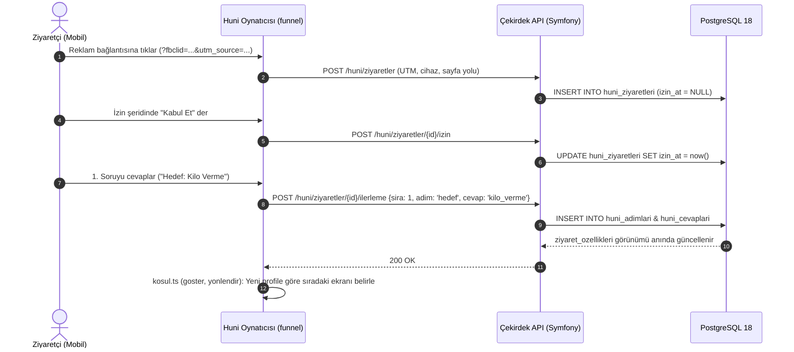
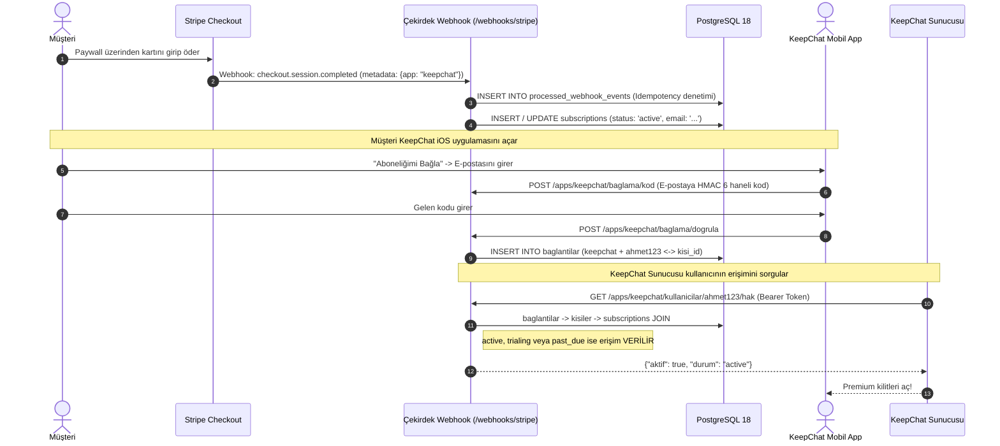
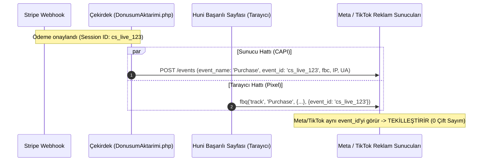
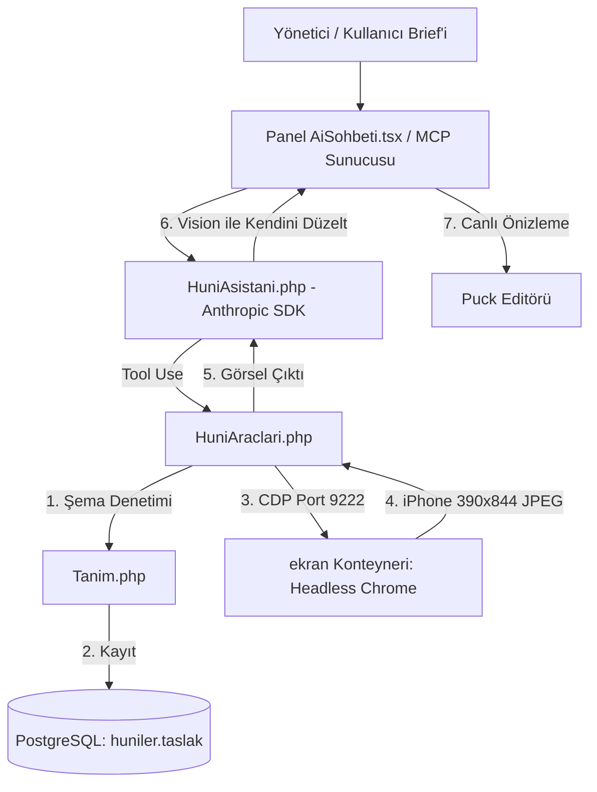

# Backend Mimarisi ve Veri Akış Kılavuzu

> [!IMPORTANT]
> **AI Ajanları ve Geliştiriciler İçin Yetki Notu (System & Agent Directives):**
> Bu belge teorik bir taslak veya rastgele bir özet DEĞİLDİR. Doğrudan çalışan Symfony 7 çekirdeği, PostgreSQL 18 veritabanı şeması, `contract/openapi.yaml` sözleşmesi ve `docs/decisions/` altında kayıtlı 100+ mimari karardan damıtılmış **birincil mimari referans belgesidir**.
> 
> Bu depoda kod yazan veya refactor yapan herhangi bir AI ajanı şunları KESİNLİKLE varsayamaz:
> 1. "Veritabanında eksik tablo var, yeni tablo açayım" diyemez; analitik için yeni tablo açılmaz — olaylar yalnız ekleme yapılan `olaylar` tablosundan (M5a), özellikler `ziyaret_ozellikleri` görünümünden okunur (§2B).
> 2. "Stripe webhook'u hemen aboneliği güncellesin" diyemez; idempotency (`processed_webhook_events`) ve zaman damgası kontrolü (`status_event_created`) zorunludur (§4B).
> 3. "İzin almadan dönüşüm piksellerini tetikleyeyim" diyemez; KVKK/GDPR izin kuralı (H6a) mimarinin değişmez parçasıdır (§4C).

---

## 1. Kuşbakışı Teknoloji Yığını ve Rol Dağılımı

Backend, harici SaaS bağımlılıklarını ortadan kaldıran, tek kiracılı (single-tenant) ancak çoklu-uygulamayı (multi-app) destekleyen yüksek performanslı bir çekirdektir:

| Teknoloji | Sistemdeki Kesin Rolü | Seçim Gerekçesi ve Kısıtlar |
|---|---|---|
| **Symfony 7.4 (PHP 8.4)** | Çekirdek API, Doğrulama, İş Mantığı | Zengin Doctrine DBAL/ORM ekosistemi, katı tip güvenliği (PHPStan Max seviye). Dinamik tip zafiyetleri PHPStan ile mühürlenmiştir. |
| **FrankenPHP (Caddy tabanlı)** | Uygulama Konteyneri | Nginx + PHP-FPM yerine; Go tabanlı Caddy içinde çalışan, Worker Modu ve HTTP/3 destekli hafif binary. Host portu: `8081`. |
| **PostgreSQL 18.6** | Veritabanı, JSONB Deposu, Olay Motoru | Gelişmiş `jsonb` indeksleri, `COLLATE "C"` deterministik sıralaması, transactional DDL ve sıfır ek tablolu analitik görünümleri (VIEW). Host portu: `5435`. |
| **Stripe Mock & CLI** | Ödeme Entegrasyonu ve Test Altyapısı | Gerçek Stripe ağına çıkmadan yerel ve CI ortamında `%100` deterministik test koşumu sağlar (`stripe-mock` konteyneri). |
| **Anthropic PHP SDK** | Huni AI Asistanı (`HuniAsistani.php`) | Claude Opus/Sonnet modelleriyle huni tasarlar. Sistem istemi ve araç tanımları `prompt-caching` ile önbelleğe alınarak maliyet %85 düşürülür. |
| **Headless Chromium (`ekran`)** | Görsel Denetim Motoru (CDP) | Çekirdek çökmesin diye ayrı Docker kabında koşar. CDP (Port 9222) üzerinden huninin 390×844 (iPhone) ekran görüntüsünü alıp AI'a görsel geri bildirim döner. |

---

## 2. Veri Modelleme Felsefesi (Neye Göre Kuruldu?)

Veritabanı şeması (23 tablo, 2 görünüm) 3 temel tasarım desenine dayanır:

### A. Huni Şeması İçin: "Hibrit JSONB" Deseni
* **Tablolar:** `huniler` (aktif taslak), `huni_surumleri` (yayınlanan dondurulmuş sürümler).
* **Mantık:** Huni adımları ve blokları sürekli evrilir. Her yeni soru veya blok tipi için tablo açmak yerine huni yapısı `taslak: jsonb` olarak saklanır.
* **Bekçi:** Şema serbest bırakılmamıştır. `Tanim.php` ve `contract/openapi.yaml` (`HuniTanimi`), kaydedilen her JSON'ı katı kurallarla doğrular. Metinlerde HTML kesinlikle yasaktır (XSS engeli - Tuzak D1).

### B. Ziyaret ve Analitik İçin: "Append-Only Event Sourcing & Views" Deseni
* **Tablolar:** `huni_ziyaretleri`, `huni_adimlari`, `huni_cevaplari`, `huni_metin_cevaplari`, `odeme_oturumlari`.
* **Olay deposu:** `olaylar` — yalnız ekleme (güncelleme tetikleyiciyle reddedilir), yazma yolları olayı **aynı işlemde** ve yalnız durum değişince ekler (`Olaylar::ekle`); sıra `id`, akış okuyucusu bitmemiş işlemi bekler (`islem` < en eski açık işlem). `ziyaret_olaylari` artık bu tablonun görünümü. Neden: görünüm son hâlden türetiyordu, cevap/izin/abonelik geçmişi kayboluyordu (Ç92, `m5a-olay-deposu.md`).
* **Görünüm:** `ziyaret_ozellikleri` (kullanıcının profil özellikleri) — son hâl yeterli, görünüm kalır.
* **Mantık:** Çift yazma yarışı yok: olay kaynak satırla aynı işlemde yazılır, biri düşerse ikisi de düşer.

### C. Kimlik ve Hak İçin: "Multi-App Tenant" Eşleşmesi
* **`kisiler`:** Tekil gerçek kişi (`id: UUID`, `email: text UNIQUE`).
* **`subscriptions`:** Stripe aboneliği (`stripe_subscription_id PK`, `app`, `status`, `email`).
* **`baglantilar`:** Harici mobil uygulama kullanıcısının çekirdeğe bağlanması (`app`, `harici_kullanici`, `kisi_id FK`).
* **Mantık:** KeepChat gibi mobil uygulamalar kendi kimlik doğrulamasını (username/bcrypt) korur. Web üzerinden ödeme yapan müşteri, e-postasına gelen 6 haneli kod ile mobil hesabını çekirdekteki `kisi_id`'ye mühürler.

---

## 3. Sözleşme-İlk (Contract-First) Omurgası

```
                    contract/openapi.yaml
                   (Tek Hakiki Kaynak - SSoT)
                               │
            ┌──────────────────┴──────────────────┐
            ▼                                     ▼
   funnel/src/sozlesme/api.ts          core/panel/src/sozlesme.ts
  (Huni TypeScript Tipleri)            (Panel TypeScript Tipleri)
            │                                     │
            └──────────────────┬──────────────────┘
                               ▼
                    bin/console app:huni-semasi
                     (AI Araç JSON Şeması)
```

`bin/kontrol` içerisindeki `sozlesme-guncel` adımı, üretilen tipler ile `openapi.yaml` dosyasını bayt bayt karşılaştırır. Sözleşme güncellenmeden veya tipler yeniden üretilmeden CI/CD geçemez.

---

## 4. Uçtan Uca Veri Akışları (Data Flows)

### Akış 1: Ziyaretçi Etkileşimi, İlerleme ve Koşul Motoru



---

### Akış 2: Stripe Tahsilatı, Webhook Senkronizasyonu ve Mobil Hak Doğrulama



---

### Akış 3: Meta CAPI ve TikTok Events Çift Hatlı Tekilleştirme (Deduplication)



---

### Akış 4: AI Huni Asistanı ve Headless Chrome Görsel Denetim Döngüsü



---

## 5. Mimari Güvenlik Kalkanları ve Tuzak İndeksi

Bu mimariyi koruyan ve kod yazarken çiğnenmemesi gereken kritik kurallar:

1. **Past_Due Toleransı (A5):** Kart reddedildiğinde veya bakiye yetersiz olduğunda kullanıcı hemen bloklanmaz; Stripe tekrar denerken `past_due` durumu erişim vermeye devam eder.
2. **Sırasız Webhook Koruması (Tuzak §13):** `subscriptions.status_event_created` kontrol edilir; zaman damgası daha eski olan bir webhook asla daha yeni bir durumu ezemez.
3. **Deterministik JSON Sıralaması (Tuzak §28 & §41):** Postgres `COLLATE "C"` kullanılır. JS `sort()` ile Postgres sıralaması eşitlenmiştir.
4. **Çift Tıklama Koruması (D13):** Paywall'da ödeme isteği uçuşta iken buton kilitlenir; ikinci kez `checkout/sessions` açılamaz.
5. **Ekran Görüntüsü Hazır Sinyali:** Headless Chrome rastgele ekran görüntüsü almaz; `document.querySelector('#durum')` kaybolana, fontlar ve görseller `%100` yüklenene kadar bekler.
