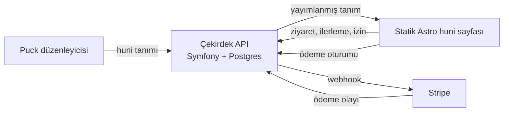

# Web2Wave huni mimarisi

Bu belge, huninin yayımlanması, tarayıcıda çalışması ve çekirdekle iletişimini
özetler. Uygulama kararları ve ölçümler için bağlantılı karar kayıtları
yetkilidir; bu belge performans veya ölçek garantisi vermez.

## Parçalar ve veri akışı

### Düzenleme ve yayın

Paneldeki Puck düzenleyicisi huni tanımını düzenler. Çekirdek bu tanımı
doğrular, taslakları ve sürümleri saklar; yayınlanan sürüm huninin çalışma
anında kullanacağı tanımdır. Önizleme de aynı tanımı ve huni bileşenlerini
kullanır. Bu yaklaşımın karşılaştırması `docs/decisions/huni-onizleme-h3.md`
ve düzenleyici yayın akışı `docs/decisions/puck-yayin-b1.md` içindedir.

### Tarayıcıda çalışma

Huni sayfası statik Astro dağıtımına göre derlenir. Tek sayfalı React oynatıcı
adımları tarayıcıda gösterir; adım değişiminde yeni sayfa isteği yapılmaz.
Tanıtım, soru ve paywall bileşenleri düzenleyiciyle paylaşılır. Huni tanımı,
API sözleşmesi ve ortak bileşen ayrıntıları için `docs/yontem/04-mimari.md`
ile `docs/decisions/huni-bilesenleri-h1.md` ve
`docs/decisions/huni-oynatici-h2.md` kayıtlarına bakın.

Huni dallanması seçenek veya tanıtım düğmesinden daha sonraki bir adıma
gidebilir; mevcut model skor hesaplaması içermez
(`docs/decisions/huni-dallanma-h5.md`). Adım geçişi CSS ile uygulanır ve
azaltılmış hareket tercihini izler (`docs/decisions/huni-gecisler-h4.md`).

### Çekirdek, ölçüm ve ödeme

Çekirdek API huni tanımlarını, ziyaret/ilerleme kayıtlarını ve ödeme
oturumlarını yönetir. Huni ile çekirdek arasındaki OpenAPI sözleşmesi
`contract/openapi.yaml` dosyasındadır; istemci tipleri buradan üretilir.

H6a itibarıyla onay şeridi Meta ve TikTok ölçüm izni ister. Tıklama
kimlikleri yalnız izin verildiyse saklanır; çekirdek izinsiz gelen kimlikleri
atar. Bu aşama tarayıcı pikseli veya sunucu dönüşüm bildiriminin
tamamlandığı anlamına gelmez. H6b ve H6c plan işidir. Ayrıntı ve tarayıcı
ölçümü `docs/decisions/huni-izin-h6a.md` içindedir.

Ödeme oturumu çekirdek üzerinden açılır; Stripe webhook'u ödeme sonucunu
çekirdeğe iletir. Huni sayfasının kendisi ödeme doğrulamaz. Ödeme akışının
güvenlik ve hata davranışları `docs/decisions/huni-paywall.md` içinde
belgelenmiştir.

## Kapsam ve sınırlar

- Statik sayfa sunumu, tek başına sunucu kapasitesi veya belirli trafik
  hacminde performans garantisi değildir; CDN ve dağıtım ölçümleri ayrıca
  yapılmalıdır.
- İstemci tarafındaki akış; ödeme, abonelik hakkı veya izin kararlarının
  yetkili kaynağı değildir. Bu denetimler çekirdekte yapılır.
- Planlanan özellikler tamamlanmış gibi sunulmaz. Huni çatısının durumu ve
  sonraki işler `PLAN.md` içindedir.
