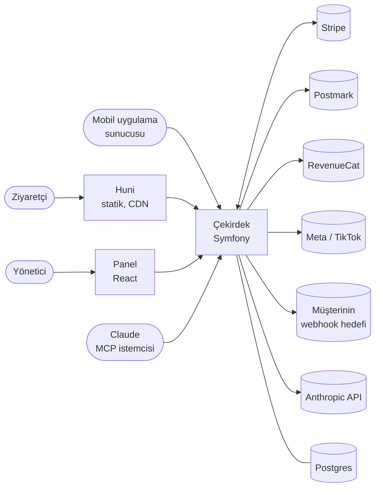
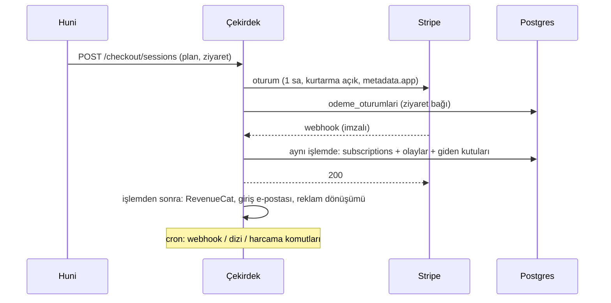
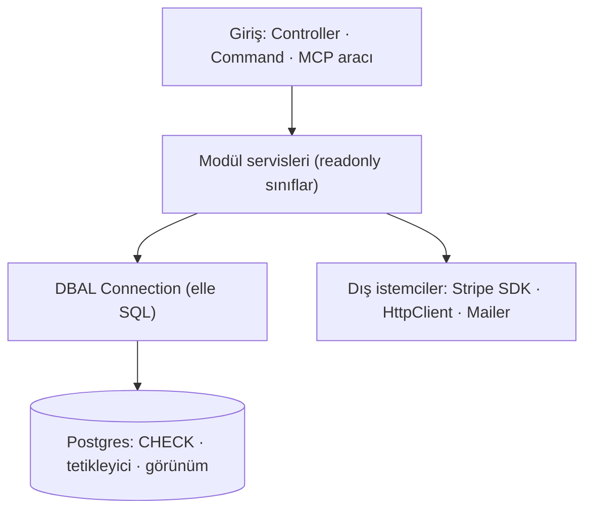

# Uygulama rehberi — panel sayfa sayfa, arkasındaki sistemle

> Uygulamayı **takip etmek ve okumak** için tek belge. Her panel sayfası aynı dört başlıkla anlatılır:
> **Ne görürsün · Ne yapabilirsin · Arkada ne çalışıyor · Henüz ölçülmeyen**. Kararların gerekçesi ve
> ölçümler burada kopyalanmaz, `docs/decisions/` kaydına bağlantı verilir.
>
> **Güncelleme kuralı:** bir blok bir sayfayı ya da arka plan işini değiştirirse, o blokta **yalnız o
> bölüm** güncellenir (`/belge` adım 4c). Adresler ve portlar `adresler.md`'de, tuzaklar `tuzaklar.md`'de.
>
> **İki bölüm:** **Kısım I** (§1–§7) sayfa sayfa ne olduğunu anlatır — okumak ve takip etmek için.
> **Kısım II** (§8–§22) mimari plandır — kod yazarken, yeni bir şey eklerken; bölüm yapısı
> `architecture-blueprint-generator` skill'inden (github/awesome-copilot, MIT; yalnız yapı alındı).
>
> Son tam gözden geçirme: 2026-11-10 (M9b1 sonrası). Önceki mimari notları (`backend-mimarisi.md`,
> `teknik-mimari-notu.md`) buraya katıldı.

---

# Kısım I — Sayfa sayfa uygulama

## 1. Uçtan uca yolculuk

```
Reklam / bağlantı
   │  ?utm_…&fbclid=…
   ▼
Huni (funnel, statik)  ──POST /huni/ziyaretler──▶  huni_ziyaretleri + olaylar
   │  izin şeridi, anket adımları, e-posta sorusu (izin kutusuyla)
   │  ──POST …/ilerleme · …/izin · …/eposta──▶  huni_adimlari · huni_cevaplari · huni_epostalari
   ▼
Paywall ──POST /checkout/sessions──▶ Stripe Checkout (e-posta önceden dolu)
   │                                      │
   │                            webhook ──▶ /webhooks/stripe → subscriptions, odeme_oturumlari,
   │                                                         odeme_faturalari, olaylar
   ▼                                      ├─▶ reklam dönüşümü (Meta CAPI / TikTok, izinliyse)
Başarılı sayfası ── giriş bağlantısı ─────├─▶ RevenueCat aktarımı
   │                                      └─▶ "Uygulamaya giriş bağlantınız" e-postası (Postmark)
   ▼
Mobil uygulama (KeepChat): bağlantıya dokunur ya da e-posta + 6 haneli kod
   │  ──POST /apps/{app}/giris/kullan · /baglama/…──▶ baglantilar (uygulama kullanıcısı ↔ kişi)
   ▼
Uygulamanın SUNUCUSU ──GET /apps/{app}/kullanicilar/{k}/hak──▶ {aktif, durum}
```

- **Kimlik:** gerçek kişi `kisiler` (e-posta tekil). Abonelik `subscriptions` (Stripe'ın kaydı). Bir uygulama
  kullanıcısı kişiye `baglantilar` ile bağlanır. Erişim veren durumlar: `active`, `trialing`, `past_due`
  (`Hak::ERISIM_VEREN`; kart reddedilince Stripe yeniden denerken erişim sürer).
- **Mobil uygulamada gizli anahtar yok:** hak sorgusunu uygulamanın sunucusu, uygulama anahtarıyla yapar
  (`uygulama-entegrasyonu.md`).
- **Abonelik yönetimi:** müşteri Stripe Customer Portal'a uygulamadan (`POST /apps/{app}/kullanicilar/{k}/portal`)
  ya da e-postayla gelen tek kullanımlık bağlantıyla (`/portal/{jeton}`) gider (`m6b1-portal.md`, `m6b2-portal-web.md`).

---

## 2. Panel sayfaları

Panel `/panel`, tek yönetici girişi. Oturum veritabanında (`sessions`). React, sözleşmeden üretilen tiplerle çalışır.

### 2.1 Rapor — `/panel`

**Ne görürsün**
- Üstte **Reklamdan gelen / Organik-doğrudan** ayrımıyla ziyaret, ödeme başladı, deneme başladı, ödedi, abone.
  - **"Ödedi":** tutar > 0 ya da faturası var. Kartlı denemenin 0 tutarlı ödemesi ödedi sayılmaz (§52, Ç118).
  - **"Dönüşüm":** abone.
- Günlük grafikler, **anket adımları** (her adıma kaç ziyaret ulaştı), **cevaplar** (cevaba göre dönüşüm).
- **Kaynak kırılımı:** UTM'e göre. Gelir, bu ziyaretlerin bugüne kadar tahsil edilen faturaları eksi iadeler.
- **Meta kampanyaları:** harcama, aynı adlı `utm_campaign` ile Meta'dan gelen ziyaretlerin geliri, ROAS. ROAS
  hesabın para biriminde, başka para birimi çevrilmez.
- **Kohort geliri:** ziyaret haftası başına birikimli gelir; "—" pencerenin henüz dolmadığı anlamına gelir.
- **Serbest yanıtlar:** metin cevapları, süreli saklanır.

**Ne yapabilirsin:** dönem seç: son 7 / 30 / 90 gün (`?gun=`; başka değer 30 olur). Başka işlem yok.

**Arkada ne çalışıyor**
- `GET /panel/api/rapor` → `App\Panel\Rapor`. Kaynaklar: `huni_ziyaretleri`, `olaylar` (`ziyaret_olaylari`
  görünümü), `odeme_oturumlari`, `odeme_faturalari` (`iade_kucuk` düşülür), `reklam_harcamalari`.
- Harcama `app:reklam-harcamalari:cek` ile Meta Insights'tan gelir (cron gerekir).
- Aynı rapor MCP'den de okunur (`RaporAraclari`, 6 araç).

**Henüz ölçülmeyen:** gerçek Meta hesabıyla çekiş (Ç121). Kayıtlar: `c118-deneme-rapor-reklam.md`, `m5a-olay-deposu.md`, `m5c-raporlar.md`, `m5d-meta-harcama.md`.

### 2.2 Huniler — `/panel/huniler` ve düzenleyici `/panel/huniler/{app}/{ad}`

**Ne görürsün**
- Uygulama başına huniler, sürümleri, varsayılan huni.
- **Yönlendirme kuralları:** reklam adresinin hangi huniyi açacağı. Üstten alta, ilk tutan kazanır.

**Ne yapabilirsin**
- Huni aç, kaldır ya da varsayılan yap; kural ekle, sil, taşı.
- Düzenleyicide (Puck) sürükle-bırakla blokları düzenle, taslağı kaydet, önizle, **yayınla**.
- Eski bir sürümü taslağa geri yükle.
- **AI sohbeti** ile taslak yazdır.

**Arkada ne çalışıyor**
- Huni tek bir JSONB belgesi olarak saklanır: `huniler.taslak`, yayınlananlar dondurulmuş olarak `huni_surumleri`'nde.
  Sorular için ayrı tablo yok.
- Her kayıt `Tanim.php` bekçisinden geçer: sözleşmedeki `HuniTanimi`, HTML yasak.
- `donustur.ts` Puck ağacı ↔ tanım dönüşümünü kayıpsız yapar.
- Yönlendirme kuralları `huni_kurallari` tablosunda. Koşul motoru (`huni-bilesenleri/kosul.ts`) göster/yönlendir
  kararlarını tarayıcıda verir.
- **AI:** `HuniAsistani`, Anthropic SDK ve araçlarla (`HuniAraclari`) çalışır; araç şeması sözleşmeden
  `app:huni-semasi` ile üretilir. `ekran` kabındaki Chromium (CDP) taslağın telefon görüntüsünü alıp AI'a geri
  verir. Ürün bağlamı (2.7) her isteğe eklenir. İstekler ve maliyet `ai_istekleri`'nde.
- **AI yalnız taslağa yazar; yayınlamak insanın işi.**
- Görseller: `medya` (yükleme ve stok arama), `/medya/{id}.webp`.

**Henüz ölçülmeyen:** `acik-uclar.md`'de "huni" geçen satırlar. Kayıtlar: `huni-yayin.md`, `huni-dallanma-h5.md`, `ai-a2-panel-arka-uc.md`, `ai-ekran-goruntusu.md` (diğerleri `huni-*`, `ai-*`).

### 2.3 Kullanıcılar — `/panel/kullanicilar`

**Ne görürsün**
- Abonelikler ve geldikleri kaynak. E-posta maskeli; tam adres Stripe'ta.
- Abonelik durumu, iptal planı ("İptal planlı — <dönem sonu>"), son fatura ve iadesi.

**Ne yapabilirsin** (iki adımlı onayla, CSRF jetonuyla)
- **Dönem sonunda iptal et** ya da **iptali geri al**.
- **Son faturayı iade et**: son faturanın iade edilmemiş kalanı.

**Arkada ne çalışıyor**
- `GET /panel/api/kullanicilar` → `Kullanicilar::liste`.
- İşlemler `AbonelikYonetimi` üzerinden Stripe'a gider; panel Stripe'ın **döndürdüğü** durumu yazar.
- İadeler `refunds.create(payment_intent)` ile yapılır. Ödeme ile fatura arasındaki bağ `fatura_odemeleri`'nde
  tutulur ve `invoice_payment.paid` olayından gelir (§54).
- Stripe panelinden yapılan iade de `charge.refunded` ile birikimli olarak düşer.
- Aynı işlemler MCP'de yalnız **yönetim izinli** anahtara açık (2.8).

**Henüz ölçülmeyen:** düğmeler tarayıcıda denenmedi. Stripe webhook uç noktası `invoice.paid`,
`invoice_payment.paid` ve `charge.refunded` ile kaydedilmeli (Ç120). Kayıt: `m6a-iptal-iade.md`.

### 2.4 Planlar — `/panel/planlar`

**Ne görürsün:** paywall'un sattığı planlar, para birimleri, teklif.

**Ne yapabilirsin**
- Plan aç: Stripe'ta ürün ve fiyat oluşur.
- Fiyat değiştir: mevcut aboneler eski fiyatta kalır.
- Para birimi başına tutar gir: boş bırakılan para birimi satılmaz.
- Teklif metnini düzenle: yalnız yeni ödemelere uygulanır.

**Arkada ne çalışıyor**
- `planlar` tablosu ve Stripe fiyatları.
- Ziyaretçinin para birimi IP'den gelen ülkeyle seçilir (DB-IP verisi, `app:ulke-verisi`). Paywall'daki birim
  ödemede `currency` ile zorlanır (§50).
- Ek satış: `ek_urunler`, `ek_satislar`, `POST /huni/ek-satis`.

**Kayıtlar:** `m1a-fiyat-katalogu.md`, `m1b-teklifler.md`, `m1c-cok-para-birimi.md`.

### 2.5 Deneyler — `/panel/deneyler`

**Ne görürsün:** deneyler, varyantlar, sonuçlar.

**Ne yapabilirsin**
- Taslakta varyant kur, sonra başlat ya da durdur.
- Deney aktif olunca sonuçlar karışmasın diye kilitlenir.

**Arkada ne çalışıyor**
- `deneyler` tablosu.
- Atama saklanmaz: sekme tohumu + deney adından belirlenir. Yalnız gösterilen varyant `ziyaret_deneyleri`'ne
  yazılır.
- Yönlendirme tipi deney trafiği hunilere böler; içerik tipi deney koşullarda `deney.ad` olarak kullanılır.
- MCP'den de kaydedilir (yönetim izni).

**Kayıtlar:** `m4a-deneyler.md`, `m4b-deney-sonuclari.md`.

### 2.6 Webhook'lar — `/panel/webhooklar`

**Ne görürsün:** uygulama başına giden webhook hedefleri ve teslim durumu.

**Ne yapabilirsin:** hedef ekle (adres + olay türleri; imza sırrı bir kez görünür), etkin/pasif yap, sil (iki adımlı onay), teslim günlüğüne bak.

**Arkada ne çalışıyor**
- `webhook_hedefleri` ve `webhook_teslimleri` tabloları.
- `app:webhook:gonder` olayları `olaylar`'dan imleçle okur. İmleç `(islem, id)`; bitmemiş işlem beklenir (§53).
- Gönderim Standard Webhooks imzasıyla ve özel ağa çıkmayan HTTP istemcisiyle yapılır.
- Kişisel veri gitmez, yalnız kimlikler. Teslim en az bir kez.

**Henüz ölçülmeyen:** cron tanımlı değil (üretim yok). Kayıtlar: `m7a-giden-webhook.md`, `m7b-webhook-paneli.md`.

### 2.7 Ürün bağlamı — `/panel/baglam`

**Ne görürsün / yapabilirsin:** uygulama başına ürün, kategori ve hedef kitle tanımı. AI huni metinlerini
yazarken bunu okur; boş alan gönderilmez.

**Arkada ne çalışıyor:** `uygulama_baglamlari` tablosu, her AI isteğinin sistem bağlamı.

### 2.8 API anahtarları — `/panel/anahtarlar`

**Ne görürsün / yapabilirsin**
- MCP anahtarı oluştur ya da iptal et. Anahtar bir kez gösterilir, saklanmaz; yalnız ilk karakterleri görünür.
- **"Abonelik ve deney yönetimi"** kutusu yazma araçlarını açar.

**Arkada ne çalışıyor**
- `api_anahtarlari` tablosu (özet ve `yonetim` bayrağı), `/mcp` uç noktası (Streamable HTTP).
- İzinsiz anahtar 13 araç görür: huni taslağı ve rapor okuma.
- İzinli anahtar 19 araç görür; fazladan abonelik listele / iptal planla / geri al / iade ve deney kaydet / durum.
- Çağrılar `mcp_cagrilari`'na yazılır.

**Kayıtlar:** `m7c1-okuma-araclari.md`, `m7c2-yazma-araclari.md`.

---

### 2.9 Ayarlar — `/panel/ayarlar`

**Ne görürsün / yapabilirsin:** uygulama başına görünen ad, URL şeması, App Store adresi ve destek e-postası.

**Arkada ne çalışıyor**
- `uygulama_ayarlari` tablosu (`UygulamaAyarlari`). Uygulama **listesi** `uygulamalar.yaml`'da kalır (A4).
- Kullanıldığı yerler:
  - **Görünen ad:** her e-postanın gönderen adı ("KeepChat <no-reply@…>").
  - **Destek e-postası:** yanıt adresi (Reply-To). Beş e-postanın hepsinde: kod, giriş bağlantısı, portal,
    aktivasyon, kurtarma.
  - **Şema:** giriş bağlantısı (`<şema>://giris?jeton=…`). iOS Info.plist ile aynı olmalı; değişirse eski bağlantılar
    açılmaz.
  - **App Store adresi:** aktivasyon e-postası.
- Ayar satırı yoksa yedek yok: şema isteyen yol hata verir.

**Henüz ölçülmeyen:** sayfa tarayıcıda denenmedi (giriş). Kayıt: `m9a-uygulama-kimligi.md`.

---

### 2.10 Yasal metinler — `/panel/yasal`

**Ne görürsün / yapabilirsin**
- Şirket unvanı, adres, kayıt no.
- Dört belge (kullanım şartları, gizlilik, KVKK, çerez) × iki dil (tr, en). Kaydedilmemiş belge **taslaktır, yayında
  değildir**; "Kaydet ve yayınla" yayınlar.
- Metinde geçen ama değeri boş yer tutucular uyarı olarak görünür.

**Arkada ne çalışıyor**
- `yasal_metinler` tablosu ve `uygulama_ayarlari`'ndaki yasal sütunlar; servis `YasalMetinler`.
- Taslaklar `Taslaklar.php`'de, sistemin ölçülmüş davranışını anlatır: 90 gün, 48 saat, izinle piksel, tarayıcıda ne
  tutulduğu. **Davranış değişirse taslak da değişir.**
- Herkese açık sayfa: `GET /yasal/{app}/{belge}/{dil}` (Twig, dış betik yok). Yer tutucular (`{{unvan}}` …) çizilirken
  dolar; boş değer "—" görünür. HTML yorumlanmaz.

**Henüz ölçülmeyen:** hukuk görüşü, huninin bu sayfalara bağlanması (M9b2), sayfanın tarayıcıda denenmesi. Kayıt:
`m9b1-yasal-metinler.md`.

---

## 3. Ziyaretçi ve uygulama tarafı (panel dışı)

| Yüz | Ne | Kayıt |
|---|---|---|
| Huni sayfaları | Statik Vite + Preact oynatıcı; yayındaki tanımı `GET /huni/{app}` ile çeker. JS bütçesi `funnel-butce` adımında | `adresler.md` §3 |
| Başarılı sayfası | Ödemeden sonra tek kullanımlık giriş bağlantısı (pencere 60 dk, oturum başına 3) + reklam pikseli (Purchase / StartTrial, sunucu olayıyla aynı `event_id`) | `kimlik-hak.md`, `c118-deneme-rapor-reklam.md` |
| Abonelik sayfası | E-postayla portal bağlantısı ister (`/huni/portal-baglantisi`) | `m6b2-portal-web.md` |
| Mobil uygulama | Giriş bağlantısı ya da e-posta + 6 haneli kod → bağlama; hak sorgusu uygulamanın sunucusundan | `uygulama-entegrasyonu.md` |

---

## 4. Arka plan işleri

### 4.1 Gelen webhook'lar

| Uç | Kimden | Ne yazar |
|---|---|---|
| `POST /webhooks/stripe` | Stripe (imzalı) | `checkout.session.completed/expired`, `customer.subscription.*`, `invoice.paid`, `invoice_payment.paid`, `charge.refunded` → abonelik, oturum, fatura, iade, olay. Tekrar `processed_webhook_events` ile engellenir, eski olay yeniyi ezmez. Ardından RevenueCat, giriş e-postası ve reklam dönüşümü kuyrukları itilir |
| `POST /webhooks/postmark` | Postmark (HTTP Basic) | Subscription Change → `posta_bastirma` (A22, `m8a1-postmark.md`) |

### 4.2 Giden işler — kuyruk + komut (üretimde cron gerekir, **henüz hiçbiri tanımlı değil**)

| Komut | Ne yapar | Kuyruk |
|---|---|---|
| `app:webhook:gonder` | Olayları hedeflere imzalı gönderir | `webhook_teslimleri` |
| `app:reklam-donusumleri:gonder` | Başarısız Meta CAPI / TikTok olaylarını yeniden dener | `reklam_donusumleri` |
| `app:revenuecat:gonder` | Bekleyen RevenueCat aktarımları | `revenuecat_gidenler` |
| `app:reklam-harcamalari:cek` | Meta harcaması (son 7 gün) | `reklam_harcamalari` |
| `app:posta:dizi` | Aktivasyon + kurtarma dizileri (15 dk cron) | `posta_dizisi` |
| `app:huni-metin-cevaplari-sil` | Süresi dolan serbest yanıtlar ve izinsiz e-postalar | — |
| `app:ulke-verisi` | DB-IP ülke verisi | — |

Giriş e-postası Stripe webhook'undan hemen sonra gider. Gidemeyen bir sonraki webhook'ta yeniden denenir; ayrı cron yok.
Bastırılmış adres atlanır.

### 4.3 E-posta

- Symfony Mailer. Dev'de Mailpit (`:8025`); testte `null://null` (§24); üretimde Postmark API (A22).
- İşlem e-postaları (`outbound` akışı): giriş kodu, giriş bağlantısı, portal bağlantısı.
- **Aktivasyon dizisi (M8a2, işlem e-postası, izin gerekmez):** ödeme e-postasından sonra 24. ve 72. saatte, uygulamaya
  hâlâ bağlanmamış kişiye yeni giriş bağlantısı (+ Ayarlar'daki App Store adresi doluysa). Durur: bağlandı,
  abonelik erişim vermiyor, adres bastırılmış. Gecikmiş adımlardan yalnız sonuncusu gider; 7 günden eski ödemeye
  başlamaz. Kayıt `posta_dizisi` (`m8a2-aktivasyon.md`).
- **Terk edilen ödeme kurtarma (M8b, pazarlama — yalnız huninin izin kutusu işaretliyse, `broadcast` akışı):**
  - Ödeme oturumu 1 saatte dolar. Stripe o zaman bir kurtarma adresi verir (30 gün geçerli). Adres açılınca aynı
    planla bir kopya oturum açılır.
  - 1. e-posta oturum dolunca, 2. e-posta oturum açıldıktan 24 saat sonra gider.
  - Durur: ödendi, aynı e-postayla abone, izin geri alındı, adres bastırıldı.
  - Aynı kişiye 7 günde tek dizi gider.
  - Abonelikten çıkma bağlantısını Postmark ekler.
  - Kopya oturum ödenince asıl ziyarete bağlanır (`kurtarildigi_oturum`). Kayıt: `m8b-kurtarma.md`.
- **Postmark pasif alıcıda hata atmaz (§57)**, bastırma listesi bunun için var.

### 4.4 Tek seferlik / bakım komutları

`app:stripe-portal:kur` (portal ayarı koddan), `app:plan-ice-aktar`, `app:huni yayinla|onizleme`,
`app:huni-arac`, `app:huni-semasi`, `app:ai-degerlendir`, `app:olaylar <ziyaret>`, `app:ozellikler`,
`app:simge-dizini`.

---

## 5. Veri omurgası (tablolar ve görünümler)

| Grup | Tablolar |
|---|---|
| Huni | `huniler`, `huni_surumleri`, `huni_kurallari`, `medya`, `uygulama_baglamlari`, `ai_istekleri` |
| Ziyaret | `huni_ziyaretleri`, `huni_adimlari`, `huni_cevaplari`, `huni_metin_cevaplari`, `huni_epostalari` (`pazarlama_izni_at`), `ziyaret_deneyleri`, `deneyler` |
| Olay deposu | `olaylar` (yalnız ekleme; güncelleme tetikleyiciyle reddedilir; kaynak satırla aynı işlemde, yalnız durum değişince) · görünümler `ziyaret_olaylari`, `ziyaret_ozellikleri` |
| Para | `planlar`, `ek_urunler`, `ek_satislar`, `odeme_oturumlari`, `subscriptions`, `odeme_faturalari`, `fatura_odemeleri`, `processed_webhook_events` |
| Kimlik | `kisiler`, `baglantilar`, `dogrulama_kodlari`, `giris_jetonlari`, `portal_jetonlari` |
| Dışa | `reklam_donusumleri`, `reklam_harcamalari`, `revenuecat_gidenler`, `webhook_hedefleri`, `webhook_teslimleri`, `posta_bastirma` |
| Erişim | `api_anahtarlari`, `mcp_cagrilari`, `sessions` |

Sayım 2026-11-10'da dev DB'den alındı: 36 tablo + 2 görünüm (göç tablosu hariç).

---

## 6. Değişmez mimari kurallar (kod yazarken)

1. **Sözleşme önce:** yeni alan önce `contract/openapi.yaml`'a yazılır, tipler `npm run uret` ile üretilir.
   `sozlesme-guncel` adımı bayt bayt karşılaştırır.
2. **Analitik için yeni tablo açılmaz:** olaylar `olaylar`'dan, özellikler `ziyaret_ozellikleri`'nden okunur.
3. **Stripe webhook'u:** tekrar engeli + zaman damgası. Alanlar gerçek nesneden okunur (yeni API, §54).
4. **İzin:** reklam pikselleri ve `fbclid`/`ttclid` saklama yalnız izinle (H6a). Pazarlama e-postası yalnız
   `pazarlama_izni_at` doluysa (A22).
5. **Kişisel veri:** log'a, giden webhook'a ve MCP listesine tam e-posta gitmez (maskeli ya da yalnız kimlik).
6. **AI yalnız taslağa yazar**; yayınlamak ve para işlemleri insanda ya da izinli anahtarda.
7. **Sıralama:** Postgres ↔ JS eşitliği için `COLLATE "C"` (§41).

---

## 7. Canlıdan önce açık olanlar (kısa liste)

Ayrıntı `acik-uclar.md`. En önemlileri:
- Stripe webhook kaydı (Ç120) ve Meta hesabı (Ç121).
- Postmark hesabı ve DNS (Ç30, Ç123).
- Cron'lar (4.2).
- Composer güvenlik güncellemeleri (Ç122).
- Panel ekranlarının tarayıcıda gözden geçirilmesi.

---

# Kısım II — Mimari plan

> Ayarlar (skill'in değişkenleri): proje türü **PHP Symfony + TypeScript (Preact / React)** · mimari **modüler monolit +
> olay deposu / giden kutusu** (koddan tespit) · diyagram **Mermaid akış + C4 tarzı** · ayrıntı **Detailed** · kod örneği
> **yok** (dosyaya bağlantı) · uygulama desenleri, karar kayıtları, genişletilebilirlik **açık**. Bizde karşılığı
> olmayan bölüm tek satırla "yok" der; dolgu yazılmaz. Ölçüm 2026-11-10.

## 8. Mimari tespit

- **Tek çekirdek (monolit), modüllere bölünmüş:** Symfony 7.4 / PHP 8.4, `core/src/<Modül>`. Mikroservis yok; modüller
  aynı süreçte, aynı veritabanında.
- **Üç ön yüz, bir sözleşme:** statik huni (Vite + Preact, `funnel/`), panel (React SPA, `core/panel/`), mobil uygulama
  (çekirdeğin dışında, yalnız HTTP). Hepsinin tipi `contract/openapi.yaml`'dan üretilir.
- **Veri erişimi ORM'siz:** Doctrine **DBAL** ile elle yazılmış SQL (`Entity/`, `Repository/` boş; ORM kullanan dosya 0).
  Kurallar Postgres'te de durur: `CHECK`, tetikleyici, görünüm.
- **Olaylar:** yalnız ekleme yapılan `olaylar` tablosu, kaynak satırla aynı işlemde yazılır. Dışarıya giden her şey
  (webhook, reklam dönüşümü, RevenueCat, e-posta dizisi) "tabloya yaz → komutla gönder" giden kutusu desenini izler.

## 9. Genel bakış — ilkeler

| İlke | Nerede görünür |
|---|---|
| Sözleşme önce | `contract/openapi.yaml` → üretilen TS tipleri; PHP testleri yanıtı sözleşmeye karşı doğrular (`Sozlesme::yanitiDogrula`) |
| Doğruluk DB'de de | Uygulama doğrular **ve** DB kısıtı aynı kuralı tutar (§4) |
| Dış sistem gelişigüzel çalışır | Webhook'lar tekrar edilebilir (tekrar engeli, eski olay yeniyi ezmez), gönderimler yeniden denenir |
| Kişisel veri en az | Log'a, giden webhook'a, MCP listesine tam e-posta gitmez; IP / tarayıcı bilgisi 48 saatte silinir |
| Ölçmeden iddia yok | Her karar testle ölçülür ve kırma denemesiyle kanıtlanır (`CLAUDE.md` §2) |

## 10. Görselleştirme

**Bağlam (C4 düzey 1)** — kim neyle konuşur:



**Kaplar (C4 düzey 2)** — `compose.yaml`'daki servisler:

| Kap | Rol | Port (yerel) |
|---|---|---|
| `core` | FrankenPHP + Symfony; API, panel kabuğu, yasal ve portal sayfaları | 8081 |
| `db` | Postgres 18.6 (`app`, testte `app_test`) | 5435 |
| `funnel` | Vite geliştirme sunucusu (üretimde statik dosya) | 4321 |
| `panel` | Panel derleme / test | — |
| `contract` | Sözleşmeden tip üretimi | — |
| `ekran` | Başsız Chromium (CDP); AI için huni ekran görüntüsü | 9222 (iç) |
| `mailpit` | Geliştirmede e-posta kutusu | 8025 |
| `stripe-mock` | Testte sahte Stripe API'si | — |
| `stripe-cli` | Araç profili (`araclar`): Stripe CLI, gerçek test hesabıyla elle iş | — |

**Para akışı (veri akışı):**



## 11. Çekirdek bileşenler (modüller)

| Modül | Sorumluluk | Ana sınıflar |
|---|---|---|
| `Huni` | Huni tanımı, doğrulama bekçisi, yayın, deneyler, ekran görüntüsü | `Tanim`, `Deneyler`, `Ekran/ChromeEkranCekici` |
| `Ai` | Huni asistanı (Claude), ürün bağlamı | `HuniAsistani`, `UrunBaglami` |
| `Atif` | Ziyaret, izin, reklam dönüşümü, harcama | `Ziyaretler`, `DonusumAktarimi`, `MetaHarcamalari` |
| `Billing` | Stripe eşitleme, abonelik yönetimi, müşteri portalı | `SubscriptionSync`, `AbonelikYonetimi`, `MusteriPortali`, `PortalBaglantisi` |
| `Kimlik` | Kişi ↔ uygulama kullanıcısı bağı, kod, giriş bağlantısı, hak | `Baglama`, `DogrulamaKodu`, `GirisBaglantisi`, `Hak` |
| `Posta` | Bastırma listesi, aktivasyon ve kurtarma dizileri | `Bastirma`, `AktivasyonDizisi`, `KurtarmaDizisi` |
| `Olay` | Olay deposu, giden webhook | `Olaylar`, `GidenWebhook`, `WebhookHedefleri` |
| `Mcp` | MCP sunucusu, rapor ve yönetim araçları, API anahtarları | `McpSunucusu`, `RaporAraclari`, `YonetimAraclari` |
| `Panel` | Rapor sorguları, kullanıcı listesi, yönetici girişi | `Rapor`, `Kullanicilar`, `YoneticiSaglayici` |
| `Uygulama` / `Yasal` | Uygulama kimliği; yasal veriler ve metinler | `UygulamaAyarlari`; `YasalMetinler`, `Taslaklar` |
| `Medya`, `Ozellik`, `RevenueCat` | Görseller; ziyaret özellikleri; RevenueCat aktarımı | — |
| `Controller` (28), `Command` (16) | HTTP ve konsol girişleri — iş mantığı modülde | — |

## 12. Katmanlar ve bağımlılıklar



- **Kural:** giriş katmanı ince; doğrulama ve iş kuralı servis sınıfında; servis DBAL'a doğrudan yazar.
- **Ölçülen modül bağımlılıkları** (`use App\…`, 2026-11-10):
  - Bağımsız: `Olay`, `Uygulama`, `Medya`, `Ozellik`, `RevenueCat`.
  - Herkes `Olay`'a ve `Uygulama`'ya yaslanır.
  - **İki döngü var:** `Billing ↔ Atif` ve `Kimlik ↔ Posta` (Ç127). Bugün sorun çıkarmıyor (aynı süreç), ama modülü
    ayırmak gerekirse ilk kırılacak yerler bunlar.

## 13. Veri mimarisi

Tablo grupları Kısım I §5'te. Desenler:
- **JSONB belge:** huni tanımı tek belge (`huniler.taslak`, `huni_surumleri`); bekçi `Tanim.php`.
- **Yalnız ekleme:** `olaylar` (güncelleme tetikleyiciyle reddedilir), imleç `(islem, id)` (§53).
- **Durum satırı + olay:** kaynak satır (ör. `subscriptions`) son hâli tutar, değişiklik aynı işlemde olaya yazılır.
- **Giden kutusu:** `webhook_teslimleri`, `reklam_donusumleri`, `revenuecat_gidenler`, `posta_dizisi`. Kayıt önce
  yazılır, gönderim sonra; başarısız olan yeniden denenir.
- **Para:** küçük birim tamsayı + para birimi (`tutar_kucuk`, `para_birimi`); ondalık metin metin olarak çevrilir (§56).

## 14. Kesişen konular

| Konu | Uygulama |
|---|---|
| Kimlik doğrulama | Panel: tek yönetici, oturum DB'de, CSRF jetonu (`panel-api`). Uygulama sunucusu: `Bearer` uygulama anahtarı. MCP: kişisel anahtar (özet saklanır), yazma araçları yalnız `yonetim` izinli anahtarda. Stripe: imza. Postmark: HTTP Basic |
| Yetki | Rol yok (A23); uygulama sınırı her sorguda `app` süzgeci |
| Doğrulama | Sunucuda; aynı kural DB `CHECK`'inde. Panel formları `noValidate` (§44) |
| Hata yönetimi | Kullanıcı yolu: 4xx + `hatalar` dizisi. Arka plan gönderimi "asla atmaz": log + yeniden deneme |
| Günlük | PSR-3 `LoggerInterface`; Monolog kurulu değil, Symfony'nin yerleşik günlükçüsü (stderr). Kişisel veri yazılmaz |
| Yapılandırma | Gizli: `.env.local`. Uygulama listesi: `uygulamalar.yaml`. Panelden değişen: DB (`uygulama_ayarlari`, `planlar`…) |
| Önbellek | Fiyat önbelleği (`fiyat.onbellegi`); statik varlıklarda içerik özeti (§30) |
| CORS | Huni kökenine izinli uçlar listesi; köken **ve** yöntem ölçülür (§36) |

## 15. Servis iletişimi

- **İç:** yalnız sınıf çağrısı. Kuyruk sistemi (Messenger) yok; zamanlanmış komutlar.
- **Gelen:** Stripe ve Postmark webhook'ları, uygulama sunucusu API'si, MCP (Streamable HTTP).
- **Giden:** Stripe SDK; `HttpClient` (Meta, TikTok, RevenueCat, webhook hedefleri — giden webhook özel ağa çıkamaz);
  Symfony Mailer → Postmark.

## 16. Teknolojiye özgü desenler

- **Symfony:** öznitelikli rotalar (`#[Route]`), `#[AsCommand]`, `#[AsEventListener]`, `#[Autowire]` ile ortam değişkeni;
  servisler `final readonly`. PHPStan en üst düzeyde.
- **Panel (React 19):** TanStack Query (veri), `openapi-fetch` (tipli istemci), React Router, Tailwind, Radix, Puck
  (düzenleyici), Recharts. Form veri gelince çizilir (yazılanı gelen veri ezmesin).
- **Huni (Preact):** bağımlılık az; JS bütçesi `bin/kontrol`'de ölçülür. Durum bellekte; tarayıcıda yalnız izin
  tercihi ve sekmelik ziyaret kimliği.

## 17. Uygulama desenleri

| Desen | Örnek | Nasıl |
|---|---|---|
| Giden kutusu + komut | `app:webhook:gonder`, `app:posta:dizi` | Aday sorgusu → işlem içinde "kayıt önce" (`ON CONFLICT DO NOTHING`) → gönder; düşerse işlem geri alınır |
| Zamanı gelen son adım | Aktivasyon, kurtarma | Adımlar azalan sırada; `adim >=` kaydı olan atlanır |
| Tekrar edilebilir webhook | `SubscriptionSync` | `processed_webhook_events` + `status_event_created` |
| Kaydedilmeden yayında değil | Yasal metinler, huni yayını | Taslak ayrı; yayın açık eylem |
| Panel uç kalıbı | `PanelUygulamaController` | Bilinmeyen uygulama 404 → CSRF 403 → servis `hatalar` → 422 / 200 |

## 18. Test mimarisi

- **Çekirdek:** PHPUnit; `WebTestCase` (gerçek HTTP yığını, `app_test` DB), `KernelTestCase` (servis).
  - Stripe: `stripe-mock` ya da istek kaydedici (`KayitliStripeIstemcisi`).
  - E-posta: `null://null` + Mailer iddiaları.
  - Sözleşme: yanıt `openapi.yaml`'a karşı doğrulanır.
- **Panel ve huni:** Vitest + happy-dom + Testing Library; sahte `fetch`.
- **Kırma:** her blokta kararlar tek tek bozulur, test kırmızı olmalı; tutmayan deneme testi suçlar (`/kirma`).
- **Gerçek sistem:** dev'de curl, Mailpit, Stripe test modu, başsız Chromium. Panel ekranları giriş istediği için
  kullanıcıda.
- **Tam kontrol:** `bin/kontrol` (biçim + statik analiz + testler + derleme); CI aynı komut (`.github/workflows/kontrol.yml`).

## 19. Dağıtım mimarisi

Üretim **yok**. Geliştirme `docker compose`; CI GitHub Actions. Canlıya geçiş kapısı `PLAN.md` §2-C'de (sağlayıcı, DNS,
cron'lar, yedek, yüzey kapatma).

## 20. Genişletme ve evrim

| Eklenecek | Adımlar |
|---|---|
| Yeni uygulama | `uygulamalar.yaml`'a satır + sözleşme `app` enum'u → panel → Ayarlar (şema zorunlu, yedek yok) → uygulama anahtarı (`.env`) |
| Yeni panel sayfası | Sözleşme → `uret` → controller (uç kalıbı §17) → `PanelController`'a sunucu rotası (§51) → `main.tsx` rota + `Duzen.tsx` menü → test (doğrudan adres dahil) |
| Yeni e-posta | `UygulamaAyarlari::eposta($app)` ile kur (gönderen adı, yanıt adresi); pazarlamaysa izin + `broadcast` akışı + bastırma |
| Yeni olay | Kaynak yazımıyla aynı işlemde `Olaylar::ekle`; yalnız durum değişince |
| Yeni dış gönderim | Giden kutusu tablosu + komut + cron; kişisel veri göndermeden önce karar |
| Yeni yasal davranış | Davranış değişince `Taslaklar.php` de değişir (Ç126) |

## 21. Karar kayıtları ve yönetişim

- **Kararlar** kopyalanmaz: neden `docs/pre-setup.md` (A1–A23), blok kaydı `docs/decisions/<konu>.md`, açık uç
  `docs/decisions/acik-uclar.md`.
- **Yönetişim:** `CLAUDE.md` kuralları; `bin/kontrol` yeşil + kırma kırmızı olmadan commit yok; `git checkout <dosya>`
  engelli; tuzaklar `docs/tuzaklar.md`.

## 22. Yeni geliştirme için plan

1. **Ölç:** mevcut durumu say (kod, DB, gerçek uç), varsayma.
2. **Karar ver:** elenen seçenek ve nedeni; kullanıcı kararı gerekiyorsa sor.
3. **Sözleşme önce** (uç varsa) → `uret`.
4. **Uygula:** cerrahi; kuralı ailenin tamamına uygula (ör. beş e-posta).
5. **Test:** kararı ölçen test; sözleşme doğrulaması; DB kısıtı için ayrı test.
6. **Kır:** her karar için bir deneme; tutmayan denemede önce testi suçla.
7. **Gerçek istekle doğrula:** dev'de curl / Mailpit / test modu.
8. **Belgele:** blok kaydı, PLAN, bu rehberde **yalnız değişen bölüm**, gerekirse tuzak ve açık uç.
9. **Commit + CI.**
