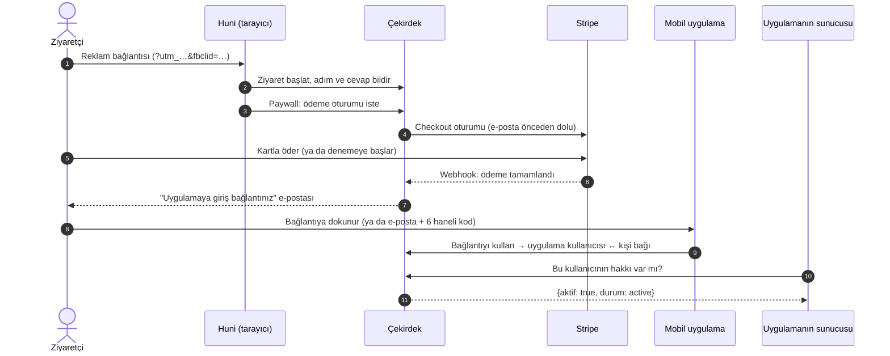
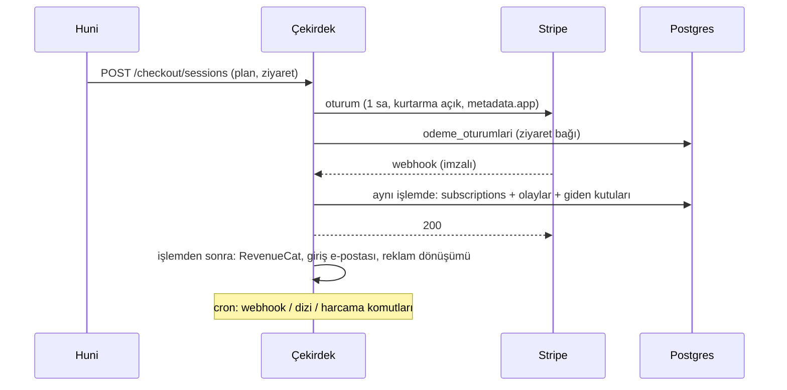
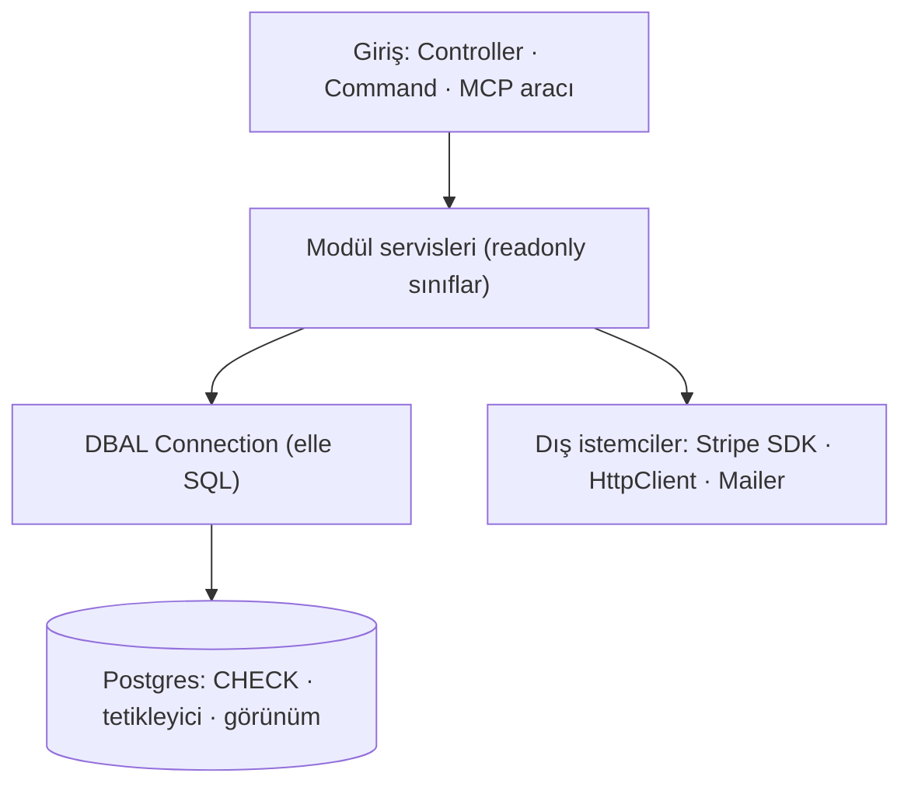

# Uygulama rehberi — panel sayfa sayfa, arkasındaki sistemle

> **Ne için:** uygulamayı takip etmek ve okumak. Her bölüm aynı sırayla anlatır: **ne işe yarar → ekranda ne var →
> ne yapabilirsin → arkada nasıl çalışır → bilinen sınırlar → kayıtlar**. Dosya ve sınıf adları tıklanabilir
> bağlantıdır (bu dosyanın klasörüne göre göreli; GitHub'da ve VS Code'da açılır, `#L31` gibi olanlar o satıra gider).
>
> **İki kısım:** **Kısım I** (§1–§7) uygulamayı sayfa sayfa anlatır. **Kısım II** (§8–§22) mimari plandır: kod
> yazarken ve yeni bir şey eklerken; bölüm yapısı `architecture-blueprint-generator` skill'inden
> (github/awesome-copilot, MIT; yalnız yapı alındı).
>
> **Güncelleme kuralı:** bir blok bir sayfayı ya da arka plan işini değiştirirse o blokta **yalnız o bölüm**
> güncellenir ([`/belge`](../.claude/skills/belge/SKILL.md) adım 4c). Adresler ve portlar [adresler.md](adresler.md)'de,
> tuzaklar [tuzaklar.md](tuzaklar.md)'de, kararların gerekçesi [pre-setup.md](pre-setup.md)'de.
>
> Son tam gözden geçirme: 2026-11-10 (M9b2 sonrası). Önceki mimari notları ([backend-mimarisi.md](backend-mimarisi.md),
> [teknik-mimari-notu.md](teknik-mimari-notu.md), [huni-mimarisi.md](huni-mimarisi.md)) buraya katıldı.

---

# Kısım I — Sayfa sayfa uygulama

## 1. Uçtan uca yolculuk

**Ne anlatır.** Bir ziyaretçinin reklamı tıklamasından, uygulamada abonelik haklarını kullanmasına kadar geçen yol.
Panel sayfalarının hepsi bu yolun bir parçasını gösterir ya da yönetir.

**Adım adım**
1. **Ziyaret.** Huni ([`Huni.tsx`](../funnel/src/oynatici/Huni.tsx)) açılınca çekirdeğe ziyaret bildirir
   ([`ziyaretBaslat`](../funnel/src/lib/ziyaret.ts#L61) → [`Ziyaretler::kaydet`](../core/src/Atif/Ziyaretler.php#L49)).
   UTM'ler saklanır; reklam tıklama kimlikleri (`fbclid`, `ttclid`) **yalnız izin şeridinde "Kabul et" denirse**.
2. **Anket.** Her ekran geçişi ve cevap bildirilir ([`ilerlemeBildir`](../funnel/src/lib/ziyaret.ts#L102) →
   [`Ziyaretler::ilerle`](../core/src/Atif/Ziyaretler.php#L222)). Hangi ekranın gösterileceğine tarayıcıdaki koşul
   motoru karar verir ([`kosul.ts`](../huni-bilesenleri/kosul.ts)). E-posta sorusu adresi ve pazarlama iznini kaydeder
   ([`Ziyaretler::epostaKaydet`](../core/src/Atif/Ziyaretler.php#L176)).
3. **Ödeme.** Paywall'da plan seçilince [`CheckoutController::__invoke`](../core/src/Controller/CheckoutController.php#L48) Stripe'ta
   bir Checkout oturumu açar: ziyaretçinin para biriminde, 1 saat geçerli, süresi dolarsa kurtarma bağlantısı açık.
   Oturum ziyarete bağlanır ([`Ziyaretler::oturumBagla`](../core/src/Atif/Ziyaretler.php#L148)), böylece ödeme hangi
   reklamdan geldiği bilinerek raporlanır.
4. **Webhook.** Stripe ödemeyi [`StripeWebhookController`](../core/src/Controller/StripeWebhookController.php) üzerinden
   bildirir; [`SubscriptionSync::apply`](../core/src/Billing/SubscriptionSync.php#L39) aboneliği, faturayı ve olayı **tek
   işlemde** yazar. Hemen ardından giriş e-postası, RevenueCat aktarımı ve (izin varsa) reklam dönüşümü gönderilir.
5. **Uygulamaya bağlanma.** Kişi e-postadaki tek kullanımlık bağlantıya telefonda dokunur
   ([`GirisBaglantisi::kullan`](../core/src/Kimlik/GirisBaglantisi.php#L84)) ya da uygulamada e-postasını yazıp 6 haneli
   kodu girer ([`DogrulamaKodu`](../core/src/Kimlik/DogrulamaKodu.php)). İkisi de uygulama kullanıcısını kişiye bağlar
   ([`Baglama`](../core/src/Kimlik/Baglama.php)).
6. **Hak sorgusu.** Uygulamanın **sunucusu** (uygulamanın kendisi değil) çekirdeğe sorar
   ([`Hak::sorgula`](../core/src/Kimlik/Hak.php#L24)). Erişim veren durumlar `active`, `trialing`, `past_due`
   ([`Hak::ERISIM_VEREN`](../core/src/Kimlik/Hak.php#L17)): kart reddedilince Stripe yeniden denerken kullanıcı kilitlenmez.

**Temel kavramlar**
- **Kişi** (`kisiler`): e-postasıyla tekil gerçek kişi. **Abonelik** (`subscriptions`): Stripe'taki aboneliğin kopyası.
  **Bağlantı** (`baglantilar`): uygulamadaki kullanıcı hesabı ↔ kişi.
- **Mobil uygulamada gizli anahtar yoktur.** Hak sorgusu uygulamanın sunucusundan, uygulama anahtarıyla yapılır
  ([uygulama-entegrasyonu.md](uygulama-entegrasyonu.md)).
- **Abonelik yönetimi** müşteride: Stripe'ın müşteri portalına uygulamadan ya da e-postayla istenen tek kullanımlık
  bağlantıyla gider ([`MusteriPortali`](../core/src/Billing/MusteriPortali.php),
  [`PortalBaglantisi`](../core/src/Billing/PortalBaglantisi.php)).

**Kayıtlar:** [kimlik-hak](decisions/kimlik-hak.md) · [giris-baglantisi](decisions/giris-baglantisi.md) ·
[atif](decisions/atif.md) · [m6b1 portal](decisions/m6b1-portal.md) · [m6b2 portal web](decisions/m6b2-portal-web.md)

---

## 2. Panel sayfaları

Panel `/panel` adresindedir ve tek bir yönetici girişiyle açılır; oturum veritabanında tutulur. Sayfalar React ile
yazılmıştır ve çekirdekle sözleşmeden ([`openapi.yaml`](../contract/openapi.yaml)) üretilen tiplerle konuşur. Değişiklik
yapan her istek, sayfanın taşıdığı CSRF jetonunu ister; başka bir siteden panel adına istek atılamaz. Menü
[`Duzen.tsx`](../core/panel/src/uygulama/Duzen.tsx)'te, rotalar [`main.tsx`](../core/panel/src/uygulama/main.tsx)'te;
her sayfanın doğrudan adresle açılabilmesi için sunucu rotası da
[`PanelController`](../core/src/Controller/PanelController.php)'dadır (tuzak §51).

**Görünüm (P6):** Apple tarzı — açık gri zemin, çerçevesiz beyaz kartlar, sistem yazı tipi, tek mavi vurgu, hap
düğmeler. Tema menünün altındaki seçiciden: Açık (varsayılan) / Koyu / Sistem; seçim tarayıcıda saklanır ve
sayfa boyanmadan önce uygulanır ([`tema.html.twig`](../core/templates/panel/tema.html.twig), [`tema.ts`](../core/panel/src/uygulama/tema.ts); P7a). Menü dört grupta: **Analiz** (Rapor, Deneyler) · **Satış** (Huniler, Planlar
ve fiyatlar) · **Müşteriler** (Aboneler) · **Ayarlar** (Uygulama, Yasal metinler, Entegrasyonlar).
Entegrasyonlar (P7d, A25) üç bölümlü tek sayfadır: Webhook'lar (2.6) · API anahtarları (2.8) · Ürün bağlamı (2.7);
eski adresler `/panel/webhooklar`, `/anahtarlar`, `/baglam` ilgili bölüme 301 ile yönlenir. Renkler [`stil.css`](../core/panel/src/uygulama/stil.css)'te ve giriş sayfası için
[`base.html.twig`](../core/templates/base.html.twig)'de; iki kopyanın aynı olduğunu ve her metin renginin 4.5:1'i
geçtiğini [`PanelRenkleriTest`](../core/tests/Panel/PanelRenkleriTest.php) ölçer.

### 2.1 Rapor — `/panel`

**Ne işe yarar.** Panelin açılış sayfası; "reklamlarım para getiriyor mu?" sorusunu cevaplar. Huniye gelen
ziyaretçinin kaçının ödeme sayfasına geçtiğini, kaçının denemeye başladığını, kaçının gerçekten para ödediğini ve bu
paranın hangi kaynaktan, hangi kampanyadan geldiğini aynı ekranda gösterir. Rapor salt okunur; hiçbir şeyi
değiştirmez.

**Ekranda ne var**

**Düzen (P7i, sekmeler; adreste `?sekme=`):** **Genel bakış** — Özet (önceki aynı uzunluktaki döneme göre değişim; oran değişimi yüzde puanı), günlük grafikler, Ziyaretten aboneliğe (reklam / organik / toplam), Reklam harcaması · **Anket** — tek huni (seçici, varsayılan en çok ziyaretli; `huni=`), şeritler (düşüş bir önceki adıma göre), o huninin cevapları, serbest yanıtlar · **Kaynaklar** — kaynak tablosu, reklam ölçümü izni · **Gelir** — kohort · **Ziyaretler** — sayfalı liste. Liste uçları yalnız açık sekmede istenir. Gelir = penceredeki ziyaretlerin bugüne kadar tahsil edilmiş faturaları eksi iade; Kaynaklar'ın gelir sütunuyla aynı tanım.

| Kart | Ne gösterir | Nasıl hesaplanır |
|---|---|---|
| Reklamdan gelen / Organik | Ziyaret → ödeme başladı → deneme başladı → ödedi → abone sayıları, iki ayrı sütunda | Ziyarette Meta/TikTok tıklama kimliği (`fbclid`, `ttclid`) ya da ücretli `utm_medium` (cpc, paid…) varsa "reklam", yoksa "organik" ([`Rapor::REKLAM`](../core/src/Panel/Rapor.php#L23)) |
| Günlük grafikler | Aynı sayıların gün gün eğrisi | Olay deposu (`ziyaret_olaylari` görünümü) güne göre sayılır |
| Anket adımları | Her ekrana kaç ziyaretçinin ulaştığı; nerede bırakıldığı | Huni her ekran geçişinde ilerleme bildirir; `huni_adimlari` tablosundan sayılır |
| Cevaplar | Her şıkkı kaç kişinin seçtiği ve o şıkkı seçenlerin kaçının abone olduğu | `huni_cevaplari` + aynı ziyaretin aboneliği başlamış ödeme oturumu |
| Kaynak kırılımı | `utm_source` / `utm_campaign`'e göre ziyaret, ödeyen ve gelir | Gelir = bu ziyaretlerin **bugüne kadar** tahsil edilen faturaları eksi iadeler |
| Meta kampanyaları | Kampanya başına Meta harcaması, getirdiği gelir, ROAS (gelir ÷ harcama) | Harcama Meta'dan çekilir; aynı adlı `utm_campaign` ile **Meta'dan** gelen ziyaretlerin geliri eşleştirilir ([`Rapor::META`](../core/src/Panel/Rapor.php#L40)) |
| Kohort geliri | Ziyaretçilerin geldiği hafta başına, ilk 24 saat / 7 / 30 / 60 günde ziyaretçi başına gelir | Pencere henüz dolmadıysa "—": yarım pencerenin geliri düşük görünürdü ([`Rapor::kohort`](../core/src/Panel/Rapor.php#L355)) |
| Serbest yanıtlar | Metin sorularına yazılanlar | 90 gün saklanır, sonra silinir |

Ziyaretler, Kaynak kırılımı ve Serbest yanıtlar 25'er satırlık sayfalarla gelir. Her biri kendi ucundan
okunur (`/panel/api/rapor/ziyaretler|kaynaklar|serbestYanitlar`, P7a2).

**Üç tanım raporu okurken önemli:**
- **"Ödedi"** = ilk ödemede gerçekten para çekildi **ya da** aboneliğin tahsil edilmiş bir faturası var
  ([`Rapor::ODEDI`](../core/src/Panel/Rapor.php#L31)). Kartlı denemede Stripe ödemeyi "paid" sayar ama tutar 0'dır;
  bu kişi "ödedi"ye değil "deneme başladı"ya girer, deneme bitip ilk fatura kesilince "ödedi"ye geçer (tuzak §52).
- **"Abone"** = abonelik başladı (deneme dahil). Deneylerde dönüşüm budur.
- **Para birimleri toplanmaz:** EUR ve TRY gelir ayrı satırlarda kalır; ROAS yalnız Meta hesabının para birimindeki
  gelirle hesaplanır, kur çevirisi yapılmaz.

**Ne yapabilirsin.** Dönemi seçersin: son 7, 30 ya da 90 gün (adreste `?gun=`; başka bir değer 30 sayılır).

**Arkada nasıl çalışır**
1. Sayfa açılınca panel [`Rapor.tsx`](../core/panel/src/uygulama/sayfalar/Rapor.tsx) `GET /panel/api/rapor?gun=30` ister.
2. [`PanelController`](../core/src/Controller/PanelController.php) girişi denetler ve [`Rapor`](../core/src/Panel/Rapor.php)
   servisinin her kart için ayrı sorgusunu çağırır (`sayimlar`, `gunluk`, `adimlar`, `cevaplar`, `utm`, `kampanyalar`,
   `kohort`…). Her sorgu ham SQL'dir; ORM yok.
3. Veriler şu tablolardan gelir: ziyaretler `huni_ziyaretleri`, olaylar `olaylar` (görünümü `ziyaret_olaylari`),
   ödeme oturumları `odeme_oturumlari`, faturalar ve iadeler `odeme_faturalari`, Meta harcaması `reklam_harcamalari`.
4. Faturalar ve iadeler Stripe webhook'uyla gelir ([`SubscriptionSync`](../core/src/Billing/SubscriptionSync.php)).
   Meta harcamasını ise [`MetaHarcamalari`](../core/src/Atif/MetaHarcamalari.php) her gün `app:reklam-harcamalari:cek`
   komutuyla çeker (cron gerekir).
5. Aynı sorgular Claude'a MCP araçları olarak da açıktır ([`RaporAraclari`](../core/src/Mcp/RaporAraclari.php)): "geçen
   haftanın Meta ROAS'ı ne?" diye sorulabilir.

**Bilinen sınırlar**
- Gerçek bir Meta reklam hesabıyla harcama çekilmedi; yanıt biçimi Meta'nın belgesinden alındı
  ([Ç121](decisions/acik-uclar.md)).
- Ülke, deney varyantı ya da huniye göre süzgeç yok; önceki dönemle karşılaştırma yok. Bunlar R1 bloğunda gelecek
  ([web2wave farkı](decisions/web2wave-platform-yapisi.md)).

**Kayıtlar:** [c118 deneme / rapor](decisions/c118-deneme-rapor-reklam.md) ·
[m5a olay deposu](decisions/m5a-olay-deposu.md) · [m5c raporlar](decisions/m5c-raporlar.md) ·
[m5d Meta harcaması](decisions/m5d-meta-harcama.md) · [m6a iade](decisions/m6a-iptal-iade.md)

### 2.2 Huniler — `/panel/huniler` ve düzenleyici `/panel/huniler/{app}/{ad}`

**Ne işe yarar.** Ziyaretçinin gördüğü anket ve paywall burada yapılır. Bir uygulamanın birden çok hunisi olabilir
(ör. farklı kampanyalar için); **yönlendirme kuralları** reklam adresine göre hangi hunin açılacağını seçer. Her huninin
bir **taslağı** (üzerinde çalışılan) ve **yayınlanmış sürümleri** (ziyaretçinin gördüğü, dondurulmuş) vardır; taslakta
yapılan değişiklik "Yayınla"ya basılmadan ziyaretçiye ulaşmaz.

**Ekranda ne var**
- **Huni listesi** ([`Huniler.tsx`](../core/panel/src/uygulama/sayfalar/Huniler.tsx)): ad, son yayınlanan sürüm,
  varsayılan işareti. Varsayılan huni, hiçbir kural tutmadığında açılır.
- **Yönlendirme kuralları:** "`utm_campaign` = `yaz` ise `yaz-hunisi`" gibi satırlar. **Üstten alta denenir, ilk tutan
  kazanır**; sıra değiştirilebilir. Kural yalnız seçim parametrelerine bakar: `k`, `utm_source`, `utm_campaign`,
  `utm_content`.
- **Düzenleyici** ([`HuniDuzenle.tsx`](../core/panel/src/uygulama/sayfalar/HuniDuzenle.tsx)): Puck tabanlı sürükle-bırak.
  Solda bloklar (başlık, metin, görsel, soru, istatistik, yorum…), ortada telefon önizlemesi, üstte Kaydet · Önizle ·
  Yayınla · Sürümler. Yanda **AI sohbeti**: "anketi 5 soruya indir" gibi isteklerle taslağı Claude düzenler.

**Ne yapabilirsin**
- Yeni huni aç: boş, başka bir huninin kopyası ya da niş şablonundan. Huniyi kaldır ya da varsayılan yap.
- Satırda Düzenle ve Aç görünür; örnek yap, varsayılan yap ve kaldır **"…" menüsünde** ([`EylemMenusu`](../core/panel/src/uygulama/ui/EylemMenusu.tsx), P7g).
- **"Yeni hunilere örnek yap":** bu huninin teması, logosu ve son paywall adımı, bundan sonra açılacak hunilere
  kopyalanır (satırda "yeni huni örneği" rozeti). "Varsayılan huni"den farklıdır: o, hiçbir kural tutmayınca açılan
  hunidir; bu ise yalnız yeni hunilerin başlangıç görünümüdür.
- Kural ekle, sil, yukarı/aşağı taşı.
- Taslağı düzenle, kaydet, önizle (imzalı, süreli bir önizleme adresiyle), yayınla. Eski bir sürümü taslağa geri al.
- AI'a taslak yazdır. **AI yalnız taslağa yazar; yayınlamak her zaman senin işin.**

**Arkada nasıl çalışır**
1. **Saklama.** Huni tek bir JSON belgesidir: taslak `huniler.taslak`'ta, her yayın `huni_surumleri`'nde yeni sürüm
   numarasıyla dondurulur. Sorular için ayrı tablo yoktur. Servis [`Huniler`](../core/src/Huni/Huniler.php):
   [`taslakKaydet`](../core/src/Huni/Huniler.php#L219), [`yayinla`](../core/src/Huni/Huniler.php#L253),
   [`surumuTaslagaAl`](../core/src/Huni/Huniler.php#L310).
2. **Bekçi.** Kaydedilen her tanım [`Tanim::hatalar`](../core/src/Huni/Tanim.php#L150)'dan geçer: sözleşmedeki
   `HuniTanimi` biçimi, var olan plan adları, metinlerde HTML yasak. Hatalı tanım kaydedilmez, yayınlanmaz.
3. **Eşzamanlı kayıt.** İki sekmede aynı taslak düzenlenirse eski sekmenin kaydı reddedilir (beklenen imza tutmaz) —
   biri ötekinin işini sessizce ezemez.
4. **Düzenleyici ↔ tanım.** Puck kendi blok ağacını tutar; [`donustur.ts`](../core/panel/src/donustur.ts) bunu tanıma ve
   geri kayıpsız çevirir. Puck'taki önizleme, huninin kendi bileşenlerini ([`bilesenler.tsx`](../huni-bilesenleri/bilesenler.tsx))
   kullanır; önizleme ile ziyaretçinin gördüğü aynıdır.
5. **Seçim.** Ziyaretçi geldiğinde [`Huniler::sec`](../core/src/Huni/Huniler.php#L48) kuralları sırayla dener, tutan
   yoksa varsayılan huniyi seçer; yönlendirme deneyi varsa trafiği varyantlara böler (2.5).
6. **AI.** [`HuniAsistani::calistir`](../core/src/Ai/HuniAsistani.php#L71) Claude'u araçlarla çalıştırır: taslağı okur, düzeltir,
   doğrulatır ve `ekran` kabındaki başsız Chromium'la taslağın telefon görüntüsünü alıp kendi işine bakar. Her isteğe
   Ürün bağlamı (2.7) eklenir; istekler ve maliyetleri `ai_istekleri`'ne yazılır.
7. **Görseller.** Yüklenen ya da stok aramasından alınan görseller `medya` tablosunda; huni `/medya/{id}.webp` ile çeker.
8. **Yeni huni görünümü.** "Örnek yap" o anki kopyayı `uygulama_ayarlari.varsayilan`'a yazar
   ([`Varsayilanlar::al`](../core/src/Huni/Varsayilanlar.php)). Yeni huni açılırken
   [`Huniler::yeniHuni`](../core/src/Huni/Huniler.php#L121) uygular: **boş** huni temayı, logoyu ve paywall'ın tamamını
   alır; **şablondan** açılan huni temayı, logoyu ve paywall'ın uygulamaya özgü alanlarını alır (planlar, güvenceler,
   şart onayı, yasal adresler, downsell; metinler şablonun); **kopya** huni hiçbir şey almaz. Kopya modelidir: örnek
   değişince var olan huniler değişmez. Örnek artık geçersizse (ör. içindeki plan yok) huni açılmaz ve gerekçe söylenir.

**Bilinen sınırlar:** huniyle ilgili açık uçlar [acik-uclar.md](decisions/acik-uclar.md)'de "huni" geçen satırlarda.

**Kayıtlar:** [m9c yeni huni görünümü](decisions/m9c-yeni-huni-gorunumu.md) · [huni-yayin](decisions/huni-yayin.md) · [huni-dallanma-h5](decisions/huni-dallanma-h5.md) ·
[ai-a2 panel arka uç](decisions/ai-a2-panel-arka-uc.md) · [ai ekran görüntüsü](decisions/ai-ekran-goruntusu.md) ·
[huni-arsiv](decisions/huni-arsiv.md)

### 2.3 Aboneler — `/panel/kullanicilar`

**Ne işe yarar.** Abonelerin listesi (basit bir CRM): kim, hangi kaynaktan geldi, aboneliği ne durumda. Destek
isteğinde "bu kişinin aboneliğini dönem sonunda iptal et" ya da "son ödemesini iade et" işlemleri buradan yapılır.

**Ekranda ne var** ([`Kullanicilar.tsx`](../core/panel/src/uygulama/sayfalar/Kullanicilar.tsx))
- Abonelik başına bir satır (P7a, taslakla bire bir):
  - **Abone:** **maskeli** e-posta (tam adres Stripe'ta durur; panelde kişisel veri az gösterilir); altında
    "3 Kasım'dan beri · uygulamaya bağlı".
  - **Durum:** renkli nokta ve Türkçe metin — Aktif, "Denemede · 15 Kasım'da biter", "İptal edildi · 1 Aralık'a
    kadar açık", Ödeme sorunlu, Bitti.
  - **Geldiği yer:** kaynak (yoksa Doğrudan) ve reklam rozeti; altında kampanya · huni.
  - **Son ödeme:** son faturanın tutarı ve tarihi ("€9,99 · 3 Kas").
- Arama kutusu ve durum için bölmeli seçici (Tümü · Aktif · Denemede · Ödeme sorunlu · Bitti).
- Başlıklara tıklanınca liste sıralanır; ikinci tık sırayı ters çevirir.
- Liste 25'er satırlık sayfalara bölünür; altta "1–25 / 312 abonelik · ‹ Önceki · Sonraki ›" yazar (P7a2).
- Arama, durum, sayfa ve sıra adreste durur (`?ara=&durum=&sayfa=&sirala=&yon=`); süzme ve sıralama
  sunucuda yapılır. Süzgeç ya da sıra değişince ilk sayfaya dönülür.
- **İşlem** sütunu:
  - Abonelik sürüyorsa "Dönem sonunda iptal et" (denemede "Deneme sonunda iptal et").
  - İptal planlıysa "İptali geri al".
  - Son faturanın iade edilmemiş kalanı varsa "€6,99 iade et".

**Ne yapabilirsin.** İptal planla, iptali geri al, son faturayı iade et. Onay satırın altında açılır ve sonucu
söyler; örneğin "€6,99 iade edilsin mi? … 3 Kasım faturası. Geri alınamaz; abonelik sürer." Düğmeler Vazgeç ve
kırmızı "İade et". Stripe'ın verdiği hata satırın altında görünür.

**Arkada nasıl çalışır**
1. Liste [`Kullanicilar::liste`](../core/src/Panel/Kullanicilar.php#L72)'den gelir.
2. İptal: [`AbonelikYonetimi::donemSonundaIptal`](../core/src/Billing/AbonelikYonetimi.php#L29) Stripe'a
   `cancel_at_period_end` gönderir ve **Stripe'ın döndürdüğü** durumu yazar — Stripe reddetse panel yalan söylemez.
3. İade: [`AbonelikYonetimi::sonFaturayiIadeEt`](../core/src/Billing/AbonelikYonetimi.php#L51) son faturanın ödemesini
   bulur ve kalan tutarı iade eder. Fatura ile ödeme arasındaki bağ Stripe'ın `invoice_payment.paid` olayından gelir
   (`fatura_odemeleri`); yeni Stripe API'de bu bağ faturanın üstünde değildir (tuzak §54).
4. Stripe panelinden yapılan iade de `charge.refunded` ile gelir ve **birikimli** düşülür
   ([`SubscriptionSync::iadeYaz`](../core/src/Billing/SubscriptionSync.php#L240)); aynı olay iki kez gelse gelir iki kez
   düşmez.
5. Aynı işlemler MCP'de yalnız **yönetim izinli** anahtara açıktır (2.8).

**Bilinen sınırlar**
- Düğmeler tarayıcıda denenmedi (giriş gerekiyor); davranış testlerle ölçüldü.
- Stripe'ta webhook uç noktası `invoice.paid`, `invoice_payment.paid` ve `charge.refunded` olaylarıyla kaydedilmeli
  ([Ç120](decisions/acik-uclar.md)).
- Duraklatma / sürdürme yok (M6c).

**Kayıtlar:** [p5 kullanıcılar](decisions/p5-kullanicilar.md) · [m6a iptal ve iade](decisions/m6a-iptal-iade.md)

### 2.4 Planlar ve fiyatlar — `/panel/planlar`

**Ne işe yarar.** Paywall'un sattığı abonelik planlarının kataloğu (haftalık, aylık, yıllık…). Plan burada açılınca
Stripe'ta ürün ve fiyat da oluşur; huni plana adıyla (`monthly`) bağlanır.

**Ekranda ne var** ([`Planlar.tsx`](../core/panel/src/uygulama/sayfalar/Planlar.tsx))
- **Planlar:** ad, tutar, dönem, Stripe fiyatı.
- **Para birimleri:** planın ana para birimine ek olarak ülkeye göre satılan tutarlar (ör. TRY 349,99).
- **Teklif:** planın giriş teklifi — ücretsiz deneme (gün), giriş fiyatı ya da yüzde indirim, isteğe bağlı bitiş tarihi.
- **Ek ürünler:** ödeme sonrası tek tıkla satılan ürünler (upsell).

**Ne yapabilirsin**
- Plan aç ([`Planlar::olustur`](../core/src/Billing/Planlar.php#L95)).
- Fiyat değiştir ([`fiyatDegistir`](../core/src/Billing/Planlar.php#L150)): Stripe'ta **yeni** fiyat açılır; mevcut
  aboneler eski fiyatta kalır, yeni ödemeler yeni fiyattan.
- Para birimi tutarlarını gir ([`paraBirimleri`](../core/src/Billing/Planlar.php#L279)): boş bırakılan para birimi satılmaz.
- Teklif koy / değiştir / kaldır ([`teklifAyarla`](../core/src/Billing/Planlar.php#L204)): yalnız yeni ödemelere uygulanır.

**Arkada nasıl çalışır**
1. Planlar `planlar` tablosunda, Stripe fiyat kimlikleriyle.
2. Ziyaretçinin para birimi IP'sinden bulunan ülkeyle seçilir ([`UlkeBulucu::ulke`](../core/src/Billing/UlkeBulucu.php#L32),
   DB-IP ülke verisi, `app:ulke-verisi` ile indirilir); o para birimi yoksa planın ana para birimi.
   [`Fiyatlar::uygulama`](../core/src/Billing/Fiyatlar.php#L42) huniye gösterilecek tutarları verir.
3. Ödemede para birimi **zorlanır**: verilmezse Stripe çok para birimli fiyatı kendi tahminiyle yerelleştirir ve paywall
   ile ödeme sayfası farklı tutar gösterir (tuzak §50). Stripe'ın otomatik kur çevirisi kapalıdır.
4. Ek satış `ek_urunler` / `ek_satislar` tablolarında, `POST /huni/ek-satis` ile kayıtlı kartla.

**Kayıtlar:** [m1a fiyat kataloğu](decisions/m1a-fiyat-katalogu.md) · [m1b teklifler](decisions/m1b-teklifler.md) ·
[m1c çok para birimi](decisions/m1c-cok-para-birimi.md)

### 2.5 Deneyler — `/panel/deneyler`

**Ne işe yarar.** A/B testi. İki tür vardır:
- **Yönlendirme deneyi:** trafiği farklı hunilere böler ("A hunisi mi B hunisi mi daha çok abone getiriyor?").
- **İçerik deneyi:** aynı huninin içinde metin ya da ekran değişir; huni koşullarda `deney.<ad>` özelliğine bakar.

**Ekranda ne var** ([`Deneyler.tsx`](../core/panel/src/uygulama/sayfalar/Deneyler.tsx)): deneyler, durumları, varyantlar ve
sonuçlar — varyant başına ziyaret, ödemeye geçen, abone, ödedi ve **kazanma olasılığı**.

**Ne yapabilirsin.** Taslakta deney kur ve varyantları trafik payıyla gir (yüzde, toplamı 100; ilk varyant kontrol
grubudur). Durumlar: **taslak → aktif → durdu ↔ aktif → bitti**. Deney başladıktan sonra varyantlar **kilitlenir** —
sonradan değişen deney sonuçları karıştırırdı. Bitmiş deney yeniden başlamaz, taslağa dönmez.

**Arkada nasıl çalışır**
1. Deney [`Deneyler::kaydet`](../core/src/Huni/Deneyler.php#L58) ile `deneyler` tablosuna yazılır; durum geçişleri
   [`durum`](../core/src/Huni/Deneyler.php#L92) (izinli geçişler [`GECISLER`](../core/src/Huni/Deneyler.php#L24)).
2. **Atama saklanmaz, hesaplanır:** tarayıcı sekmesinin rastgele "tohumu" + deney adından varyant belirlenir
   ([`yonlendir`](../core/src/Huni/Deneyler.php#L130), [`icerik`](../core/src/Huni/Deneyler.php#L143)). Sayfa yenilense de
   aynı ziyaretçi aynı varyantı görür. Yalnız **gösterilen** varyant `ziyaret_deneyleri`'ne yazılır.
3. Sonuç [`sonuclar`](../core/src/Huni/Deneyler.php#L196): sayım ziyaret başına; "ödedi" tutardan (kartlı deneme sayılmaz).
4. Deneyler MCP'den de kurulabilir (yönetim izni, 2.8).

**Kayıtlar:** [m4a deneyler](decisions/m4a-deneyler.md) · [m4b deney sonuçları](decisions/m4b-deney-sonuclari.md)

### 2.6 Webhook'lar — `/panel/entegrasyonlar#webhooklar`

**Ne işe yarar.** Uygulamadaki olayları (ödeme, abonelik durumu, adım, cevap…) senin seçtiğin bir sunucuya gerçek
zamanlı gönderir; ör. kendi CRM'ine ya da Zapier'e. Kişisel veri gönderilmez, yalnız kimlikler.

**Ekranda ne var** ([`Webhooklar.tsx`](../core/panel/src/uygulama/sayfalar/Webhooklar.tsx)): uygulama başına hedefler
(adres, olaylar, etkin / pasif) ve her hedefin teslim günlüğü (başarılı, başarısız, yeniden denenecek). Olaylar
Türkçe adlarıyla üç grupta seçilir (Huni · Ödeme · Abonelik), grup başına "Tümü"; adlar
[`olaylar.ts`](../core/panel/src/uygulama/olaylar.ts)'te, sözlükle eşliğini `PanelOlayAdlariTest` ölçer.

**Ne yapabilirsin.** Hedef ekle (imza sırrı **bir kez** görünür, sakla), etkinleştir / durdur, sil (iki adımlı onay),
teslim günlüğüne bak, başarısız teslimi yeniden gönder.

**Arkada nasıl çalışır**
1. Hedefler `webhook_hedefleri`'nde ([`WebhookHedefleri`](../core/src/Olay/WebhookHedefleri.php)).
2. Dakikalık komut `app:webhook:gonder` iki iş yapar: yeni olayları olay deposundan okuyup her hedefin kuyruğuna koyar
   ([`GidenWebhook::kuyruga`](../core/src/Olay/GidenWebhook.php#L41)), zamanı gelenleri gönderir
   ([`gonder`](../core/src/Olay/GidenWebhook.php#L75)); kayıt `webhook_teslimleri`'nde.
3. Olay deposu bitmemiş veritabanı işlemlerini bekleyerek okunur (imleç `(islem, id)`); aksi hâlde aynı anda yazılan
   bir olay sessizce atlanırdı (tuzak §53).
4. Her istek Standard Webhooks biçiminde imzalanır ([`imza`](../core/src/Olay/GidenWebhook.php#L116)); alıcı sırla
   doğrular. İstekler özel ağ adreslerine gidemez (iç sunuculara saldırı yolu olmasın).
5. Teslim "en az bir kez"dir: alıcı aynı olayı iki kez alabilir, olay kimliğiyle tekilleştirmelidir.

**Bilinen sınırlar:** dağıtım betiğinde `app:webhook:gonder` cron'u yok (Ç133).

**Kayıtlar:** [m7a giden webhook](decisions/m7a-giden-webhook.md) · [m7b webhook paneli](decisions/m7b-webhook-paneli.md) · [p7d entegrasyonlar](decisions/p7d-entegrasyonlar.md)

### 2.7 Ürün bağlamı (AI) — `/panel/entegrasyonlar#baglam`

**Ne işe yarar.** AI'a uygulamanı tanıtır: ürün ne yapıyor, kategori, hedef kitle, ton ve asla yazılmaması gerekenler.
AI huni metinlerini bu bağlamla yazar; bağlam olmadan metinler belirgin şekilde genel ve kötü çıkar.

**Ekranda ne var / ne yapabilirsin** ([`Baglam.tsx`](../core/panel/src/uygulama/sayfalar/Baglam.tsx)): beş alan, karakter
sınırlarıyla; kaydet. Boş alan AI'a gönderilmez.

**Arkada nasıl çalışır:** `uygulama_baglamlari` tablosu ([`UrunBaglami`](../core/src/Ai/UrunBaglami.php)); her AI isteğinin
sistem bilgisine eklenir.

**Kayıtlar:** [ai-a4 ürün bağlamı](decisions/ai-a4-urun-baglami.md)

### 2.8 API anahtarları — `/panel/entegrasyonlar#anahtarlar`

**Ne işe yarar.** Claude Code ya da Claude Desktop'un MCP ile panele bağlanmasını sağlar: Claude raporları okuyabilir,
huni taslağı düzenleyebilir; izin verilirse abonelik ve deney işlemleri de yapabilir.

**Ekranda ne var** ([`Anahtarlar.tsx`](../core/panel/src/uygulama/sayfalar/Anahtarlar.tsx)): anahtarlar (yalnız ilk
karakterleri; anahtarın kendisi saklanmaz), MCP adresi, yeni anahtar formu ve **"Abonelik ve deney yönetimi"** kutusu.

**Ne yapabilirsin.** Anahtar oluştur (bir kez gösterilir, hemen kopyala), iptal et. İptal edilenler listede değil,
katlanır **"İptal edilenler (N)"** bölümündedir; oradan iki adımlı onayla kalıcı silinir. Etkin anahtar silinemez,
önce iptal edilir (A25).

**Arkada nasıl çalışır**
1. Anahtarın yalnız özeti `api_anahtarlari`'nda ([`ApiAnahtarlari::olustur`](../core/src/Mcp/ApiAnahtarlari.php#L30)).
2. `/mcp` isteğinde anahtar doğrulanır ([`dogrula`](../core/src/Mcp/ApiAnahtarlari.php#L48)) ve sunucu o anahtarın
   uygulamasıyla kurulur ([`McpSunucusu::kur`](../core/src/Mcp/McpSunucusu.php#L45)).
3. **İzinsiz anahtar** 13 araç görür: huni taslağı ve rapor okuma. **İzinli anahtar** 19 araç görür: ek olarak
   abonelik listele / iptal planla / geri al / iade ve deney kaydet / durum
   ([`YonetimAraclari`](../core/src/Mcp/YonetimAraclari.php)). İzinsiz anahtar bu araçları hiç görmez — yalnız
   istemcinin onay sorusuna güvenilmez.
4. Her çağrı `mcp_cagrilari`'na yazılır; anahtar silinince ([`sil`](../core/src/Mcp/ApiAnahtarlari.php)) yalnız onunkiler de silinir.

**Kayıtlar:** [m7c1 okuma araçları](decisions/m7c1-okuma-araclari.md) · [m7c2 yazma araçları](decisions/m7c2-yazma-araclari.md)

### 2.9 Uygulama — `/panel/ayarlar`

**Ne işe yarar.** Canlıya çıkmadan önce yapılacaklar ve uygulamanın kimliği: e-postalarda görünen ad, yanıtların
gideceği destek adresi, App Store adresi, giriş bağlantısının uygulamayı açtığı adres şeması.

**Ekranda ne var / ne yapabilirsin** ([`Ayarlar.tsx`](../core/panel/src/uygulama/sayfalar/Ayarlar.tsx)), üç bölüm (P7c):
1. **Canlıya geçiş:** altı adım (Stripe, Stripe bildirimleri, Postmark, yasal metinler, Meta reklam hesabı, otomatik
   görevler), sayaç ve çubuk. Her adım sistemden ölçülür
   ([`CanliyaGecis`](../core/src/Uygulama/CanliyaGecis.php), ölçütler [p7c kaydında](decisions/p7c-uygulama.md)).
   Eksik adımda "Nasıl yapılır" hangi ortam değişkeninin yazılacağını söyler.
2. **Uygulama bilgileri:** dört alan; kaydet. Hatalı değer (ör. büyük harfli şema, `http://` adres) sunucuda
   reddedilir ve gerekçesi satırda görünür.
3. **Yeni hunilerin görünümü:** yeni hunilere kopyalanan görünüm hangi huniden, ne zaman alındı, neleri içeriyor (tema,
   logo, paywall); "Kaldır" ile yeni huniler yeniden boş başlar (2.2, adım 8).

| Alan | Nerede kullanılır |
|---|---|
| Görünen ad | Her e-postanın gönderen adı ("KeepChat <no-reply@…>") |
| Destek e-postası | Her e-postanın yanıt adresi (Reply-To): kod, giriş bağlantısı, portal, aktivasyon, kurtarma |
| Uygulamayı açan bağlantı (URL şeması) | Giriş bağlantısı `keepchat://giris?jeton=…`. **iOS uygulamasının Info.plist'indekiyle aynı olmalı**; değiştirirsen daha önce gönderilen bağlantılar açılmaz |
| App Store adresi | Aktivasyon e-postasındaki "uygulamayı kurun" bağlantısı |

**Arkada nasıl çalışır**
1. `uygulama_ayarlari` tablosu ([`UygulamaAyarlari`](../core/src/Uygulama/UygulamaAyarlari.php)). Uygulamaların **listesi**
   ise [`uygulamalar.yaml`](../core/config/packages/uygulamalar.yaml)'dadır, çünkü sözleşmedeki uygulama listesiyle eşlidir.
2. Beş e-postanın hepsi [`UygulamaAyarlari::eposta`](../core/src/Uygulama/UygulamaAyarlari.php) ile kurulur; yeni bir
   e-posta da böyle kurulmalı (§20).
3. Ayar satırı yoksa yedek değer yoktur: şema isteyen yol açık hata verir. İki kaynak olsaydı hangisinin geçerli olduğu
   görünmezdi (tuzak §12).
4. Zamanlı komutlar başarıyla bitince [`GorevKaydi`](../core/src/Uygulama/GorevKaydi.php) `zamanli_gorevler`'e yazar;
   "Otomatik görevler" adımı buradan okunur.

**Kayıtlar:** [m9a uygulama kimliği](decisions/m9a-uygulama-kimligi.md) · [m9c yeni huni görünümü](decisions/m9c-yeni-huni-gorunumu.md) · [p7c canlıya geçiş](decisions/p7c-uygulama.md)

### 2.10 Yasal metinler — `/panel/yasal`

**Ne işe yarar.** Kullanım şartları, gizlilik politikası, KVKK aydınlatma metni ve çerez bildirimi — Türkçe ve
İngilizce. Hazır gelen metinler sistemin gerçekte ne yaptığını anlatan **taslaklardır, hukuki görüş değildir**;
yayınlamadan önce bir hukukçuya gösterilmelidir.

**Ekranda ne var** ([`Yasal.tsx`](../core/panel/src/uygulama/sayfalar/Yasal.tsx))
- **Yasal veriler:** şirket unvanı, adres, kayıt no (isteğe bağlı).
- Her belge için bir kart, dil seçimiyle: metin alanı, durum ("Taslak — yayında değil" ya da "Yayında · adres"),
  değeri boş yer tutucular için uyarı.

**Ne yapabilirsin.** Verileri kaydet; metni düzenle ve **"Kaydet ve yayınla"**. Kaydetmediğin belge yayında değildir
ve huniden de bağlantı verilmez.

**Metin biçimi:** `## ` başlık, `- ` madde, `**kalın**`, boş satır yeni paragraf. HTML yazılmaz; yazılırsa olduğu gibi
görünür. Yer tutucular: `{{uygulama}}`, `{{unvan}}`, `{{adres}}`, `{{kayitNo}}`, `{{eposta}}` (destek e-postası).

**Arkada nasıl çalışır**
1. Metinler `yasal_metinler`'de, yasal veriler `uygulama_ayarlari`'nda ([`YasalMetinler`](../core/src/Yasal/YasalMetinler.php)).
2. Taslaklar [`Taslaklar.php`](../core/src/Yasal/Taslaklar.php)'de. Sistemin ölçülmüş davranışını anlatırlar: serbest
   yanıtlar 90 gün, IP / tarayıcı bilgisi en geç 48 saat, pikseller yalnız izinle, tarayıcıda ne tutulduğu. **Bu
   davranışlardan biri değişirse taslak da değişmeli.**
3. Herkese açık sayfa `GET /yasal/{app}/{belge}/{dil}` ([`YasalController`](../core/src/Controller/YasalController.php),
   [`yasal.html.twig`](../core/templates/yasal.html.twig)). Yer tutucular sayfa açılırken doldurulur: unvanı
   değiştirirsen sekiz metni yeniden kaydetmen gerekmez. Boş değer "—" görünür. Kaydedilmemiş belge 404.
4. **Huniye bağlantı:** huni yanıtı yalnız yayındaki belgelerin adresini verir
   ([`HuniController`](../core/src/Controller/HuniController.php)). Paywall adımında şartlar / gizlilik adresi girilmemişse
   bu adresler kullanılır (adımın kendi adresi önce gelir); izin şeridi çerez bildirimine ve gizliliğe bağlanır
   ([`IzinSeridi.tsx`](../funnel/src/oynatici/IzinSeridi.tsx)).

**Bilinen sınırlar:** hukuki gözden geçirme yok; huniye yalnız Türkçe adresler veriliyor (dile göre seçim M9d); KVKK
metnine huniden doğrudan bağlantı yok ([Ç126](decisions/acik-uclar.md)).

**Kayıtlar:** [m9b1 yasal metinler](decisions/m9b1-yasal-metinler.md) · [m9b2 yasal bağlantılar](decisions/m9b2-yasal-baglantilar.md)

---

## 3. Ziyaretçi ve uygulama tarafı (panel dışı)

**Ne anlatır.** Panelde görünmeyen ama ziyaretçinin ve mobil uygulamanın kullandığı yüzler.

| Yüz | Ne işe yarar | Nasıl çalışır | Kayıt |
|---|---|---|---|
| Huni sayfası | Anket ve paywall | Statik sayfa + Preact oynatıcı ([`Huni.tsx`](../funnel/src/oynatici/Huni.tsx)); yayındaki tanımı `GET /huni/{app}` ile çeker. Durum bellekte; tarayıcıda yalnız izin tercihi ([`izin.ts`](../funnel/src/lib/izin.ts)) ve sekmelik ziyaret kimliği tutulur | [huni-oynatici-h2](decisions/huni-oynatici-h2.md) |
| İzin şeridi | Meta / TikTok ölçümü için izin; "Reddet" ve "Kabul et" eşit ağırlıkta | [`IzinSeridi.tsx`](../funnel/src/oynatici/IzinSeridi.tsx); pikseller yalnız kabulde yüklenir ([`reklam-pikselleri.ts`](../funnel/src/lib/reklam-pikselleri.ts)) | [huni-izin-h6a](decisions/huni-izin-h6a.md) |
| Başarılı sayfası | Ödemeden sonra uygulamaya giriş bağlantısı | Bağlantı yalnız ödemeden sonraki 60 dakikada ve oturum başına en çok 3 kez alınır ([`GirisBaglantisi::sayfaIcin`](../core/src/Kimlik/GirisBaglantisi.php#L52)); reklam pikseli sunucu olayıyla aynı kimlikle gider (çift sayım olmaz) | [giris-baglantisi](decisions/giris-baglantisi.md) |
| Abonelik sayfası | E-postayla portal bağlantısı ister | [`PortalBaglantisi::iste`](../core/src/Billing/PortalBaglantisi.php#L37): bağlantı 60 dakika, tek kullanımlık | [m6b2 portal web](decisions/m6b2-portal-web.md) |
| Yasal sayfalar | Şartlar, gizlilik, KVKK, çerez | 2.10 | [m9b1](decisions/m9b1-yasal-metinler.md) |
| Mobil uygulama | Bağlanma ve hak | Giriş bağlantısı ya da e-posta + 6 haneli kod (10 dakika); hak sorgusu uygulamanın sunucusundan | [uygulama-entegrasyonu](uygulama-entegrasyonu.md) |

---

## 4. Arka plan işleri

**Ne anlatır.** Kimse bir düğmeye basmadan çalışan işler: dış sistemlerden gelen bildirimler, dışarıya gönderilen
kayıtlar ve e-postalar. Hepsi aynı ilkeyle çalışır: **önce veritabanına yaz, sonra gönder; gidemeyen yeniden denenir.**

### 4.1 Gelen webhook'lar

| Uç | Kimden | Ne yapar |
|---|---|---|
| `POST /webhooks/stripe` ([`StripeWebhookController`](../core/src/Controller/StripeWebhookController.php)) | Stripe, imzalı | Ödeme oturumu tamamlandı / süresi doldu, abonelik oluştu / değişti / bitti, fatura ödendi, ödeme bağı, iade → [`SubscriptionSync::apply`](../core/src/Billing/SubscriptionSync.php#L39). Aynı olay ikinci kez gelirse işlenmez; eski tarihli olay yeni durumu ezmez. Ardından giriş e-postası, RevenueCat ve reklam dönüşümü kuyrukları itilir |
| `POST /webhooks/postmark` ([`PostmarkWebhookController`](../core/src/Controller/PostmarkWebhookController.php)) | Postmark, HTTP Basic | Bir adres bastırıldı (geri döndü, şikâyet, abonelikten çıktı) ya da yeniden etkinleşti → [`Bastirma`](../core/src/Posta/Bastirma.php) |

### 4.2 Giden işler — kuyruk + komut

Üretimde her biri bir cron ister. `deploy/sunucu-hazirla.sh` yalnız üçünü kuruyor (Ç133); her komutun son başarılı çalışması `zamanli_gorevler`'de, panelde Uygulama → Canlıya geçiş.

| Komut | Ne yapar | Kuyruk tablosu | Sıklık önerisi |
|---|---|---|---|
| `app:webhook:gonder` | Olayları müşterinin hedeflerine imzalı gönderir (2.6) | `webhook_teslimleri` | dakikada bir |
| `app:posta:dizi` | Aktivasyon ve kurtarma e-postaları (4.3) | `posta_dizisi` | 15 dakikada bir |
| `app:reklam-donusumleri:gonder` | Gidemeyen Meta CAPI / TikTok olaylarını yeniden dener ([`DonusumAktarimi::gonder`](../core/src/Atif/DonusumAktarimi.php#L143)) | `reklam_donusumleri` | birkaç dakikada bir |
| `app:revenuecat:gonder` | Bekleyen RevenueCat aktarımları | `revenuecat_gidenler` | birkaç dakikada bir |
| `app:reklam-harcamalari:cek` | Meta harcaması, son 7 gün (Meta yakın günleri düzeltir) | `reklam_harcamalari` | günde bir |
| `app:huni-metin-cevaplari-sil` | 90 günü geçen serbest yanıtlar ve izinsiz e-postalar | — | günde bir |
| `app:ulke-verisi` | DB-IP ülke verisi | — | ayda bir |

Giriş e-postası ayrı komut beklemez: Stripe webhook'undan hemen sonra gider; gidemeyen bir sonraki webhook'ta yeniden
denenir ([`GirisBaglantisi::epostalariGonder`](../core/src/Kimlik/GirisBaglantisi.php#L112)).

### 4.3 E-posta

- Gönderim Symfony Mailer ile: geliştirmede Mailpit (`localhost:8025`), testte hiçbir yere (`null://null`, tuzak §24),
  üretimde Postmark API.
- **İşlem e-postaları** (Postmark `outbound` akışı, izin gerekmez): doğrulama kodu, giriş bağlantısı, portal bağlantısı,
  aktivasyon hatırlatması.
- **Aktivasyon dizisi** ([`AktivasyonDizisi`](../core/src/Posta/AktivasyonDizisi.php)): ödeme e-postasından sonra 24. ve
  72. saatte, uygulamaya hâlâ bağlanmamış kişiye yeni giriş bağlantısı (+ App Store adresi). Durur: bağlandı, abonelik
  erişim vermiyor, adres bastırılmış. Gecikmiş adımlardan yalnız sonuncusu gider; 7 günden eski ödemeye başlamaz.
- **Kurtarma dizisi** ([`KurtarmaDizisi`](../core/src/Posta/KurtarmaDizisi.php)): pazarlama e-postası — yalnız huninin
  izin kutusu işaretliyse, Postmark `broadcast` akışından (abonelikten çıkma bağlantısını Postmark ekler). Ödeme oturumu
  1 saatte dolunca Stripe 30 gün geçerli bir kurtarma bağlantısı verir; 1. e-posta oturum dolunca, 2. e-posta 24 saat
  sonra. Durur: ödendi, aynı e-postayla abone, izin geri alındı, adres bastırıldı. Aynı kişiye 7 günde tek dizi.
- **Bastırma** ([`Bastirma`](../core/src/Posta/Bastirma.php)): Postmark bastırılmış adrese göndermez **ve Symfony bunu hata
  olarak bildirmez** — e-posta gitmez ama gitti görünür (tuzak §57). Bu yüzden [`PostmarkTeslimDinleyicisi`](../core/src/Posta/PostmarkTeslimDinleyicisi.php)
  o olayı yakalar ve kuyruklar bastırılmış adresi atlar.

**Kayıtlar:** [m8a1 Postmark](decisions/m8a1-postmark.md) · [m8a2 aktivasyon](decisions/m8a2-aktivasyon.md) ·
[m8b kurtarma](decisions/m8b-kurtarma.md)

### 4.4 Tek seferlik ve bakım komutları

`app:stripe-portal:kur` (müşteri portalının Stripe ayarını koddakiyle aynı yapar) · `app:plan-ice-aktar` (Stripe'taki
var olan bir fiyatı kataloğa alır) · `app:huni yayinla|onizleme` · `app:huni-arac` (AI araçlarını konsoldan çalıştırır)
· `app:huni-semasi` (sözleşmeden AI araç şeması üretir) · `app:ai-degerlendir` (model karşılaştırması) ·
`app:olaylar <ziyaret>` ve `app:ozellikler` (bir ziyaretin olaylarını / özelliklerini gösterir) · `app:simge-dizini`.

---

## 5. Veri omurgası

**Ne anlatır.** Hangi bilginin hangi tabloda durduğu. Tablolar [göçlerle](../core/migrations/) kurulur; ORM yoktur,
kuralların bir kısmı veritabanında da durur (`CHECK` kısıtları, tetikleyiciler).

| Grup | Tablolar | Ne tutar |
|---|---|---|
| Huni | `huniler`, `huni_surumleri`, `huni_kurallari`, `medya`, `uygulama_baglamlari`, `ai_istekleri` | Taslaklar, yayın sürümleri, yönlendirme kuralları, görseller, AI bağlamı ve istekleri |
| Ziyaret | `huni_ziyaretleri`, `huni_adimlari`, `huni_cevaplari`, `huni_metin_cevaplari`, `huni_epostalari`, `ziyaret_deneyleri`, `deneyler` | Ziyaretçinin UTM'leri, izni, adımları, cevapları, e-postası ve pazarlama izni, deney varyantı |
| Olay deposu | `olaylar` · görünümler `ziyaret_olaylari`, `ziyaret_ozellikleri` | Olan her şeyin değişmez günlüğü: yalnız eklenir, güncellenemez; kaynak kayıtla aynı işlemde ve yalnız durum değişince yazılır ([`Olaylar::ekle`](../core/src/Olay/Olaylar.php#L60)) |
| Para | `planlar`, `ek_urunler`, `ek_satislar`, `odeme_oturumlari`, `subscriptions`, `odeme_faturalari`, `fatura_odemeleri`, `processed_webhook_events` | Katalog, ödeme oturumları (ziyaret bağı), abonelikler, faturalar ve iadeler, işlenmiş Stripe olayları |
| Kimlik | `kisiler`, `baglantilar`, `dogrulama_kodlari`, `giris_jetonlari`, `portal_jetonlari` | Kişiler, uygulama bağları, kısa ömürlü kod ve jetonlar (yalnız özetleri) |
| Dışa | `reklam_donusumleri`, `reklam_harcamalari`, `revenuecat_gidenler`, `webhook_hedefleri`, `webhook_teslimleri`, `posta_bastirma`, `posta_dizisi` | Giden kutuları, harcama, bastırma listesi, dizi kayıtları |
| Ayar ve erişim | `uygulama_ayarlari`, `yasal_metinler`, `api_anahtarlari`, `mcp_cagrilari`, `sessions`, `zamanli_gorevler` | Uygulama kimliği, yasal metinler, MCP anahtarları ve çağrıları, panel oturumları, zamanlı komutların son çalışması |

---

## 6. Değişmez mimari kurallar (kod yazarken)

1. **Sözleşme önce:** yeni alan önce [`openapi.yaml`](../contract/openapi.yaml)'a yazılır, tipler `npm run uret` ile
   üretilir; `bin/kontrol` üretilen dosyanın güncel olduğunu bayt bayt denetler. Satır içi açıklamada tırnaksız virgül
   üreticiyi sessizce keser (tuzak §48).
2. **Analitik için yeni tablo açılmaz:** olaylar `olaylar`'dan, özellikler `ziyaret_ozellikleri`'nden okunur.
3. **Stripe webhook'u:** tekrar engeli ve zaman damgası zorunlu; alanlar gerçek nesneden okunur (yeni API, tuzak §54).
4. **İzin:** reklam pikselleri ve tıklama kimlikleri yalnız izinle; pazarlama e-postası yalnız `pazarlama_izni_at` doluysa.
5. **Kişisel veri:** log'a, giden webhook'a ve MCP listesine tam e-posta gitmez.
6. **AI yalnız taslağa yazar;** yayınlamak ve para işlemleri insanda ya da izinli anahtarda.
7. **Sıralama:** Postgres ↔ JavaScript eşitliği için `COLLATE "C"` (tuzak §41).

## 7. Canlıdan önce açık olanlar (kısa liste)

Ayrıntı [acik-uclar.md](decisions/acik-uclar.md)'de:
- Stripe webhook kaydı (Ç120) ve Meta reklam hesabı (Ç121).
- Postmark hesabı, `broadcast` akışı ve alan adı DNS'i (Ç30, Ç123, Ç125).
- Cron'lar (§4.2).
- Composer güvenlik güncellemeleri (Ç122).
- Yasal metinlerin hukuki gözden geçirmesi (Ç126).
- Panel ekranlarının tarayıcıda gözden geçirilmesi.

---

# Kısım II — Mimari plan

> Ayarlar (skill'in değişkenleri): proje türü **PHP Symfony + TypeScript (Preact / React)** · mimari **modüler monolit +
> olay deposu / giden kutusu** (koddan tespit) · diyagram **Mermaid akış + C4 tarzı** · ayrıntı **Detailed** · kod örneği
> **yok** (dosyaya bağlantı) · uygulama desenleri, karar kayıtları, genişletilebilirlik **açık**. Bizde karşılığı
> olmayan bölüm tek satırla "yok" der; dolgu yazılmaz. Ölçüm 2026-11-10.

## 8. Mimari tespit

**Kısaca:** tek bir sunucu uygulaması (çekirdek), onu kullanan üç ön yüz ve dış sistemlerle konuşan bir dizi kuyruk.

- **Tek çekirdek, modüllere bölünmüş:** Symfony 7.4 / PHP 8.4, [`core/src/<Modül>`](../core/src/). Mikroservis yoktur;
  modüller aynı süreçte, aynı veritabanında çalışır. Bu, tek şirketin uygulaması için en az işletme yükü demektir.
- **Üç ön yüz, bir sözleşme:** huni ([`funnel/`](../funnel/), statik + Preact), panel ([`core/panel/`](../core/panel/),
  React), mobil uygulama (çekirdeğin dışında, yalnız HTTP). Hepsinin tipi [`openapi.yaml`](../contract/openapi.yaml)'dan
  üretilir; bir uç değişince üç taraf da derleme anında haberdar olur.
- **ORM'siz veri erişimi:** Doctrine DBAL ile elle yazılmış SQL. ORM kullanan dosya yoktur (`Entity/`, `Repository/`
  boş). Rapor sorguları gibi karmaşık SQL'ler bu yüzden doğrudan okunabilir.
- **Olaylar ve giden kutusu:** olan her şey yalnız eklenen `olaylar` tablosuna, kaynak kayıtla **aynı işlemde** yazılır.
  Dışarıya giden her şey (webhook, reklam dönüşümü, RevenueCat, e-posta dizisi) "tabloya yaz → komut gönderir" desenini
  izler: dış sistem çökse de kayıt kaybolmaz.

## 9. Genel bakış — ilkeler

| İlke | Ne demek | Nerede görünür |
|---|---|---|
| Sözleşme önce | Uç önce sözleşmede tanımlanır | Üretilen TS tipleri; PHP testleri yanıtı sözleşmeye karşı doğrular ([`Sozlesme`](../core/tests/Support/Sozlesme.php)) |
| Doğruluk veritabanında da | Uygulama denetimi atlansa da DB kuralı tutar | Her tabloda `CHECK`; DB kısıtını ayrıca ölçen testler (tuzak §4) |
| Dış sistem gelişigüzel çalışır | Bildirim tekrar gelir, sırası karışır, karşı taraf düşer | Tekrar engeli, "eski olay yeniyi ezmez", yeniden deneme |
| Kişisel veri en az | Gerekmedikçe tutulmaz, gösterilmez, gönderilmez | Maskeli e-posta, 48 saatte silinen IP, kimlikle giden webhook |
| Ölçmeden iddia yok | Her karar testle ölçülür ve bozularak kanıtlanır | [`CLAUDE.md`](../CLAUDE.md) §2, `/kirma` |

## 10. Görselleştirme

**Bağlam (C4 düzey 1)** — kim neyle konuşur:

**Kaplar (C4 düzey 2)** — [`compose.yaml`](../compose.yaml)'daki servisler:

| Kap | Rol | Port (yerel) |
|---|---|---|
| `core` | FrankenPHP + Symfony; API, panel kabuğu, yasal ve portal sayfaları | 8081 |
| `db` | Postgres 18.6 (`app`, testte `app_test`) | 5435 |
| `funnel` | Vite geliştirme sunucusu (üretimde statik dosya) | 4321 |
| `panel` | Panel derleme / test | — |
| `contract` | Sözleşmeden tip üretimi | — |
| `ekran` | Başsız Chromium (CDP); AI için huni ekran görüntüsü | 9222 (iç) |
| `mailpit` | Geliştirmede e-posta kutusu | 8025 |
| `stripe-mock` | Testte sahte Stripe API'si | — |
| `stripe-cli` | Araç profili (`araclar`): Stripe CLI, gerçek test hesabıyla elle iş | — |

**Para akışı (veri akışı):**

## 11. Çekirdek bileşenler (modüller)

| Modül | Sorumluluk | Ana sınıflar |
|---|---|---|
| [`Huni`](../core/src/Huni/) | Huni tanımı, doğrulama bekçisi, yayın, deneyler, ekran görüntüsü | [`Tanim`](../core/src/Huni/Tanim.php), [`Huniler`](../core/src/Huni/Huniler.php), [`Deneyler`](../core/src/Huni/Deneyler.php), [`ChromeEkranCekici`](../core/src/Huni/Ekran/ChromeEkranCekici.php) |
| [`Ai`](../core/src/Ai/) | Huni asistanı (Claude), ürün bağlamı, maliyet | [`HuniAsistani`](../core/src/Ai/HuniAsistani.php), [`UrunBaglami`](../core/src/Ai/UrunBaglami.php) |
| [`Atif`](../core/src/Atif/) | Ziyaret, izin, reklam dönüşümü, harcama | [`Ziyaretler`](../core/src/Atif/Ziyaretler.php), [`DonusumAktarimi`](../core/src/Atif/DonusumAktarimi.php), [`MetaHarcamalari`](../core/src/Atif/MetaHarcamalari.php) |
| [`Billing`](../core/src/Billing/) | Stripe eşitleme, katalog, abonelik yönetimi, müşteri portalı | [`SubscriptionSync`](../core/src/Billing/SubscriptionSync.php), [`Planlar`](../core/src/Billing/Planlar.php), [`AbonelikYonetimi`](../core/src/Billing/AbonelikYonetimi.php), [`MusteriPortali`](../core/src/Billing/MusteriPortali.php) |
| [`Kimlik`](../core/src/Kimlik/) | Kişi ↔ uygulama kullanıcısı bağı, kod, giriş bağlantısı, hak | [`Baglama`](../core/src/Kimlik/Baglama.php), [`DogrulamaKodu`](../core/src/Kimlik/DogrulamaKodu.php), [`GirisBaglantisi`](../core/src/Kimlik/GirisBaglantisi.php), [`Hak`](../core/src/Kimlik/Hak.php) |
| [`Posta`](../core/src/Posta/) | Bastırma listesi, aktivasyon ve kurtarma dizileri | [`Bastirma`](../core/src/Posta/Bastirma.php), [`AktivasyonDizisi`](../core/src/Posta/AktivasyonDizisi.php), [`KurtarmaDizisi`](../core/src/Posta/KurtarmaDizisi.php) |
| [`Olay`](../core/src/Olay/) | Olay deposu, giden webhook | [`Olaylar`](../core/src/Olay/Olaylar.php), [`GidenWebhook`](../core/src/Olay/GidenWebhook.php), [`WebhookHedefleri`](../core/src/Olay/WebhookHedefleri.php) |
| [`Mcp`](../core/src/Mcp/) | MCP sunucusu, rapor ve yönetim araçları, API anahtarları | [`McpSunucusu`](../core/src/Mcp/McpSunucusu.php), [`RaporAraclari`](../core/src/Mcp/RaporAraclari.php), [`YonetimAraclari`](../core/src/Mcp/YonetimAraclari.php), [`ApiAnahtarlari`](../core/src/Mcp/ApiAnahtarlari.php) |
| [`Panel`](../core/src/Panel/) | Rapor sorguları, kullanıcı listesi, yönetici girişi | [`Rapor`](../core/src/Panel/Rapor.php), [`Kullanicilar`](../core/src/Panel/Kullanicilar.php), [`YoneticiSaglayici`](../core/src/Panel/YoneticiSaglayici.php) |
| [`Uygulama`](../core/src/Uygulama/) / [`Yasal`](../core/src/Yasal/) | Uygulama kimliği; yasal veriler ve metinler | [`UygulamaAyarlari`](../core/src/Uygulama/UygulamaAyarlari.php); [`YasalMetinler`](../core/src/Yasal/YasalMetinler.php), [`Taslaklar`](../core/src/Yasal/Taslaklar.php) |
| [`Medya`](../core/src/Medya/), [`Ozellik`](../core/src/Ozellik/), [`RevenueCat`](../core/src/RevenueCat/) | Görseller; ziyaret özellikleri; RevenueCat aktarımı | — |
| [`Controller`](../core/src/Controller/) (28), [`Command`](../core/src/Command/) (16) | HTTP ve konsol girişleri; iş mantığı modüldedir | — |

## 12. Katmanlar ve bağımlılıklar

- **Kural:** giriş katmanı incedir (kimlik, CSRF, durum kodu); doğrulama ve iş kuralı servis sınıfındadır; servis
  veritabanına doğrudan yazar. Örnek: [`PanelUygulamaController`](../core/src/Controller/PanelUygulamaController.php) →
  [`UygulamaAyarlari::kaydet`](../core/src/Uygulama/UygulamaAyarlari.php).
- **Ölçülen modül bağımlılıkları** (`use App\…` satırları, 2026-11-10):
  - Kimseye bağımlı olmayanlar: `Olay`, `Uygulama`, `Medya`, `Ozellik`, `RevenueCat`.
  - Herkes `Olay`'a ve `Uygulama`'ya yaslanır.
  - **İki döngü var:** `Billing ↔ Atif` (ödeme reklam dönüşümünü tetikler; atıf ödeme oturumunu okur) ve
    `Kimlik ↔ Posta` (giriş e-postası bastırma listesine bakar; aktivasyon dizisi giriş bağlantısı üretir). Tek süreçte
    sorun değil; modül ayırmak gerekirse ilk çözülecek yerler bunlar ([Ç127](decisions/acik-uclar.md)).

## 13. Veri mimarisi

Tablo grupları §5'te. Kullanılan desenler:
- **JSON belge:** huni tanımı tek belge (`huniler.taslak`, `huni_surumleri`); biçimi [`Tanim`](../core/src/Huni/Tanim.php) bekçisi tutar.
- **Yalnız ekleme:** `olaylar` güncellenemez (tetikleyici reddeder); okuyucu bitmemiş işlemi bekler (imleç `(islem, id)`,
  [`Olaylar::BITMIS`](../core/src/Olay/Olaylar.php#L48), tuzak §53).
- **Durum kaydı + olay:** kaynak kayıt (ör. `subscriptions`) son hâli tutar; değişiklik aynı işlemde olay olarak yazılır.
- **Giden kutusu:** `webhook_teslimleri`, `reklam_donusumleri`, `revenuecat_gidenler`, `posta_dizisi`. Kayıt önce
  yazılır, gönderim sonra; başarısız olan yeniden denenir.
- **Para:** küçük birim tamsayı + para birimi (`tutar_kucuk`, `para_birimi`); dış sistemin ondalık metni metin olarak
  çevrilir, kayan noktaya sokulmaz (tuzak §56).

## 14. Kesişen konular

| Konu | Nasıl çözülmüş |
|---|---|
| Kimlik doğrulama | Panel: tek yönetici, oturum DB'de, CSRF jetonu (`panel-api`). Uygulama sunucusu: `Bearer` uygulama anahtarı. MCP: kişisel anahtar (özeti saklanır); yazma araçları yalnız `yonetim` izinli anahtarda. Stripe: imza. Postmark: HTTP Basic |
| Yetki | Rol yok (A23, tek yönetici); uygulama sınırı her sorguda `app` süzgeciyle |
| Doğrulama | Sunucuda; aynı kural DB `CHECK`'inde. Panel formlarında tarayıcı denetimi kapalı (`noValidate`) — tarayıcı sessizce takılmasın, sunucu gerekçe söylesin (tuzak §44) |
| Hata yönetimi | Kullanıcı yolu: 4xx + `hatalar` dizisi. Arka plan gönderimi "asla atmaz": log'a yazar, sonra yeniden dener |
| Günlük | PSR-3 `LoggerInterface`; Monolog kurulu değil, Symfony'nin yerleşik günlükçüsü (stderr). Kişisel veri yazılmaz |
| Yapılandırma | Gizli değerler `.env.local`'da (git dışı). Uygulama listesi [`uygulamalar.yaml`](../core/config/packages/uygulamalar.yaml). Panelden değişenler DB'de (`uygulama_ayarlari`, `planlar`…) |
| Önbellek | Fiyat önbelleği; huni yanıtı ziyaretçinin tarayıcısında kısa süre (ülkeye göre fiyat yüzünden ortak önbellek yok); statik dosyalarda içerik özeti (tuzak §30) |
| CORS | Huni kökenine izinli uçlar listesi; köken **ve** yöntem ölçülür (tuzak §36) |

## 15. Servis iletişimi

- **İç:** yalnız sınıf çağrısı. Kuyruk sistemi (Messenger) kurulu değil; zamanlanmış komutlar kullanılır.
- **Gelen:** Stripe ve Postmark webhook'ları, uygulama sunucusu API'si, MCP (Streamable HTTP, [`McpController`](../core/src/Controller/McpController.php)).
- **Giden:** Stripe SDK; HTTP istemcisi (Meta, TikTok, RevenueCat, webhook hedefleri — giden webhook özel ağa çıkamaz);
  Symfony Mailer → Postmark; Anthropic SDK.

## 16. Teknolojiye özgü desenler

- **Symfony:** öznitelikli rotalar (`#[Route]`), komutlar (`#[AsCommand]`), olay dinleyicileri (`#[AsEventListener]`),
  `#[Autowire]` ile ortam değişkeni; servisler `final readonly`. PHPStan en üst düzeyde.
- **Panel (React 19):** TanStack Query (veri), `openapi-fetch` (tipli istemci), React Router, Tailwind, Radix, Puck
  (düzenleyici), Recharts. Form, veri gelince çizilir — yoksa yazılanı gelen veri ezerdi.
- **Huni (Preact):** bağımlılık az; JS boyut bütçesi `bin/kontrol`'de ölçülür. Durum bellekte; tarayıcıda yalnız izin
  tercihi ve sekmelik ziyaret kimliği.

## 17. Uygulama desenleri

| Desen | Örnek | Nasıl |
|---|---|---|
| Giden kutusu + komut | [`GidenWebhook`](../core/src/Olay/GidenWebhook.php), [`AktivasyonDizisi`](../core/src/Posta/AktivasyonDizisi.php) | Aday sorgusu → işlem içinde "kayıt önce" (`ON CONFLICT DO NOTHING`) → gönder; düşerse işlem geri alınır, sonra yeniden denenir |
| Zamanı gelen son adım | Aktivasyon, kurtarma | Adımlar azalan sırada denenir; daha ileri adımı kayıtlı olan atlanır |
| Tekrar edilebilir webhook | [`SubscriptionSync`](../core/src/Billing/SubscriptionSync.php) | `processed_webhook_events` + olay zamanı karşılaştırması |
| Kaydedilmeden yayında değil | Yasal metinler, huni yayını | Taslak ayrı; yayın açık bir eylem |
| Panel uç kalıbı | [`PanelUygulamaController`](../core/src/Controller/PanelUygulamaController.php) | Bilinmeyen uygulama 404 → CSRF 403 → servisin `hatalar`ı → 422 / 200 |

## 18. Test mimarisi

- **Çekirdek** ([`core/tests/`](../core/tests/)): PHPUnit; `WebTestCase` (gerçek HTTP yığını, `app_test` veritabanı),
  `KernelTestCase` (servis).
  - Stripe: `stripe-mock` ya da istek kaydedici ([`KayitliStripeIstemcisi`](../core/tests/Support/KayitliStripeIstemcisi.php)).
  - E-posta: `null://null` + Symfony'nin e-posta iddiaları.
  - Sözleşme: yanıt [`openapi.yaml`](../contract/openapi.yaml)'a karşı doğrulanır.
- **Panel ve huni:** Vitest + happy-dom + Testing Library; ağ yerine sahte `fetch`.
  - Panel sayfa testleri çizilmiş sayfada her alanın ortak stilde olduğunu denetler ([`ciplakAlanlar`](../core/panel/src/uygulama/ui/stilDenetimi.ts), P7e); Vitest'te CSS boş olduğu için sınıfa bakar (tuzak §32).
- **Kırma:** her blokta kararlar tek tek bozulur, test kırmızı olmalı; tutmayan denemede önce test suçlanır
  ([`/kirma`](../.claude/skills/kirma/SKILL.md)).
- **Gerçek sistem:** dev'de curl, Mailpit, Stripe test modu, başsız Chromium. Panel ekranları
  [`bin/panel-ekran`](../bin/panel-ekran) ile: ayrı kapta test kullanıcısıyla 8 sayfa × 2 tema × 2 genişlik, yanında
  yerleşim ölçümü (taşma, kayan kap, ekran dışı menü; açılır durumlar ad ile, ör. `huniler-menu`) (A26,
  [p7f](decisions/p7f-ekran-dongusu.md), [p7g](decisions/p7g-menu-ve-telefon-kartlari.md)).
- **Tam kontrol:** [`bin/kontrol`](../bin/kontrol) (biçim + statik analiz + testler + derleme); CI aynı komutu koşar
  ([`kontrol.yml`](../.github/workflows/kontrol.yml)).

## 19. Dağıtım mimarisi

Üretim **yok**. Geliştirme `docker compose`, CI GitHub Actions. Canlıya geçiş kapısı [`PLAN.md`](../PLAN.md) §2-C'de
(sağlayıcılar, DNS, cron'lar, yedek, sunucu yüzeyini kapatma).

## 20. Genişletme ve evrim

| Eklenecek | Adımlar |
|---|---|
| Yeni uygulama | [`uygulamalar.yaml`](../core/config/packages/uygulamalar.yaml)'a satır + sözleşmede `app` listesi → panel → Ayarlar (şema zorunlu, yedek yok) → uygulama anahtarı (`.env.local`) |
| Yeni panel sayfası | Sözleşme → `uret` → controller (uç kalıbı §17) → [`PanelController`](../core/src/Controller/PanelController.php)'a sunucu rotası (§51) → [`main.tsx`](../core/panel/src/uygulama/main.tsx) rota + [`Duzen.tsx`](../core/panel/src/uygulama/Duzen.tsx) menü → test (doğrudan adres dahil) |
| Yeni e-posta | [`UygulamaAyarlari::eposta`](../core/src/Uygulama/UygulamaAyarlari.php) ile kur (gönderen adı, yanıt adresi); pazarlamaysa izin + `broadcast` akışı + bastırma |
| Yeni olay | Kaynak kaydıyla aynı işlemde [`Olaylar::ekle`](../core/src/Olay/Olaylar.php#L60); yalnız durum değişince |
| Yeni dış gönderim | Giden kutusu tablosu + komut + cron; kişisel veri göndermeden önce karar |
| Yeni yasal davranış | Davranış değişince [`Taslaklar.php`](../core/src/Yasal/Taslaklar.php) de değişir ([Ç126](decisions/acik-uclar.md)) |

## 21. Karar kayıtları ve yönetişim

- **Kararlar kopyalanmaz:** nedeni [pre-setup.md](pre-setup.md) (A1–A23), blok kaydı [`decisions/`](decisions/), açık uç
  [acik-uclar.md](decisions/acik-uclar.md). Kayıtlar yazıldıkları günün durumunu anlatır; sonradan değişen bir şey
  kaydın başında "sonra değişti" notuyla işaretlenir.
- **Yönetişim:** [`CLAUDE.md`](../CLAUDE.md) kuralları; `bin/kontrol` yeşil + kırma kırmızı olmadan commit yok;
  `git checkout <dosya>` engelli; tuzaklar [tuzaklar.md](tuzaklar.md).

## 22. Yeni geliştirme için plan

1. **Ölç:** mevcut durumu say (kod, DB, gerçek uç); varsayma.
2. **Karar ver:** elenen seçenek ve nedeni; kullanıcı kararı gerekiyorsa sor.
3. **Sözleşme önce** (uç varsa) → `uret`.
4. **Uygula:** cerrahi; kuralı ailenin tamamına uygula (ör. beş e-postanın hepsi).
5. **Test:** kararı ölçen test; sözleşme doğrulaması; DB kısıtı için ayrı test.
6. **Kır:** her karar için bir deneme; tutmayan denemede önce testi suçla.
7. **Gerçek istekle doğrula:** dev'de curl / Mailpit / Stripe test modu.
8. **Belgele:** blok kaydı, PLAN, bu rehberde **yalnız değişen bölüm**, gerekirse tuzak ve açık uç.
9. **Commit + CI.**
